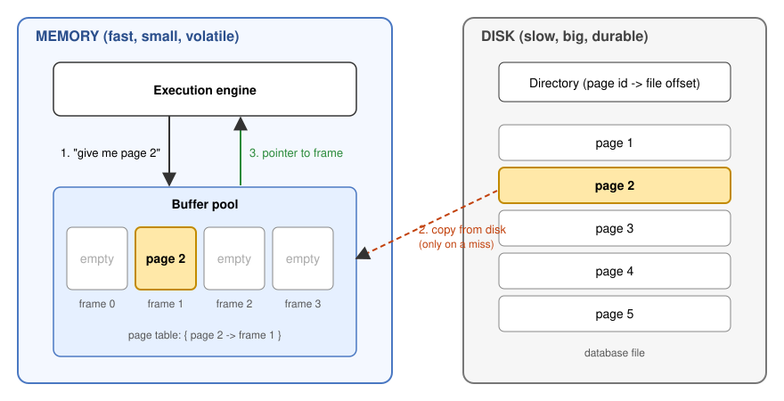
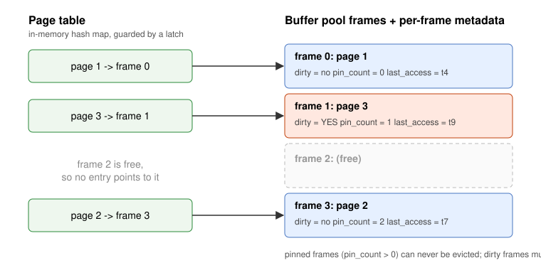
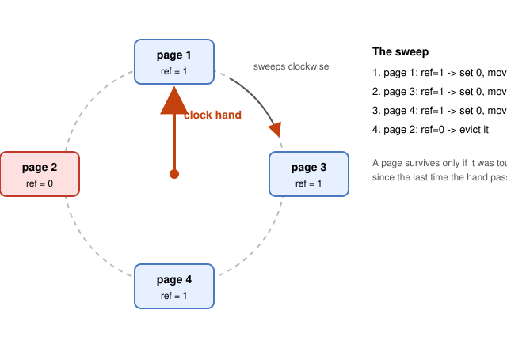
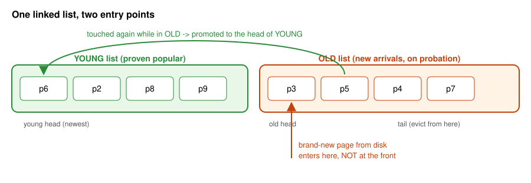
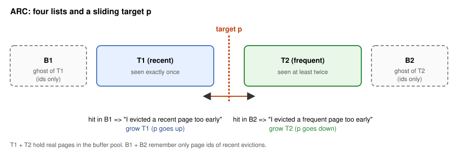

::: {.callout-note appearance="simple"}
**Watch the lecture this post is based on:** [CMU 15-445/645 Database Systems, Lecture 04: Buffer Pools (Prof. Andy Pavlo)](https://www.youtube.com/watch?v=8-2yv4z0VZc&list=PLSE8ODhjZXjYMAgsGH-GtY5rJYZ6zjsd5&index=4)

All the ideas here come from that lecture and its slides. The diagrams, examples and code are my own re-drawings, so any mistakes are mine.
:::

<!--
Optional: embed the video directly instead of linking it.

-->

## The problem in one sentence

A database can be far bigger than RAM, but it can only *work on* data that is in RAM. Something has to sit in the middle and decide:

- which pages to pull into memory,
- which pages to throw out when memory is full,
- and when to write changed pages back to disk.

That something is the **buffer pool manager**. This post walks through how it works, why it is almost always a better manager than the operating system, and the replacement policies (LRU, Clock, LRU-K, ARC and friends) that decide who gets evicted.
This blog is mostly a rambling ( with usage of claude to make me sound "legit" about my understanding of buffer pools in DBs in memory)
## A desk and a library

The mental model I found most useful:

- **Disk** is a huge library. It holds everything, but fetching a book takes a long walk.
- **Memory** is your desk. It is small, but anything on it is instantly available.
- The **buffer pool** is the *desk management strategy*: which books stay open, which go back to the shelf, and which you scribbled notes in (and therefore can't just throw away).

Every decision in this lecture is a version of "the desk is full and I need space for one more book; what do I put back?"

## Two kinds of control

The lecture frames the whole storage layer with two ideas:

| | Question it answers | Goal |
|---|---|---|
| **Spatial control** | *Where* on disk do we write pages? | Keep pages that are used together physically close, so reads are sequential. |
| **Temporal control** | *When* do we read pages into memory and write them back? | Minimize the number of times a query stalls waiting for disk. |

Last lecture was mostly spatial (how pages are laid out in files). This lecture is temporal.

## How the buffer pool is organized

The buffer pool is just a big chunk of memory split into an array of **fixed-size slots called frames**. Each frame can hold exactly one page (same size as a disk page, commonly 4 KB to 16 KB depending on the system).

{#fig-arch fig-alt="Diagram of an execution engine, a buffer pool with four frames, and a disk containing a directory and five pages. Arrows show a page request, a copy from disk, and a pointer returned."}

Let's trace what happens in @fig-arch:

1. The execution engine says "I need page 2."
2. The buffer pool checks whether page 2 is already in a frame. If not, it copies an **exact copy** of the page from disk into a free frame.
3. It returns a **pointer to the frame**. The engine reads or modifies the bytes directly in memory.

Notice what the engine never does: it never talks to the disk itself. Everything goes through the buffer pool.

### Writes are lazy (write-back cache)

If a query modifies page 2, the DBMS does **not** write it to disk immediately. It modifies the in-memory copy and marks the frame as **dirty**. The write to disk happens later (on eviction, or by a background writer). This is called a **write-back cache**, and it is a big reason databases are fast: ten updates to the same page cost one disk write, not ten.

## The metadata that makes it work

A frame by itself is just bytes. The buffer pool keeps extra bookkeeping so it can answer questions quickly.

{#fig-pagetable fig-alt="A page table with three entries pointing to frames, with each frame labeled with dirty flag, pin count and last access time. One frame is free."}

**The page table** is an in-memory hash table: `page_id -> frame`. When someone asks for page 3, we hash, look it up, and either find the frame (a **hit**) or don't (a **miss**).

**Per-frame metadata:**

- **Dirty flag.** "This page was modified and the disk copy is stale."
- **Pin / reference counter.** "Someone is using this page right now." A pinned page must never be evicted. Imagine a query is halfway through reading a page and the buffer pool yanks it away; that would be a disaster. Pin on the way in, unpin when done.
- **Access tracking info.** Timestamps, reference bits, or access counts, whatever the replacement policy needs.

Putting it all together, here is the full life of a page request:

```{mermaid}
%%| fig-cap: "Life of a page request inside the buffer pool manager."
flowchart TD
    A["Engine asks for page 42"] --> B{"In page table?"}
    B -- "yes (hit)" --> C["Pin the frame, return pointer"]
    B -- "no (miss)" --> D{"Free frame?"}
    D -- "yes" --> G["Read page 42 from disk into the frame"]
    D -- "no" --> E["Pick a victim with the replacement policy (never a pinned frame)"]
    E --> F{"Victim dirty?"}
    F -- "yes (slow path)" --> H["Write victim to disk"]
    F -- "no (fast path)" --> I["Just drop it"]
    H --> I
    I --> G
    G --> C
```

### Page table vs. page directory (easy to mix up)

These sound alike but are different things:

| | Page **directory** | Page **table** |
|---|---|---|
| Maps | page id -> *location in the database files on disk* | page id -> *frame in the buffer pool* |
| Lives | On disk (must survive restart) | In memory only (rebuilt from nothing after a restart) |

### Locks vs. latches

Another pair of words people conflate. Many threads hit the page table at the same time, so it needs protection, but not with the same thing that protects your rows.

| | **Lock** | **Latch** |
|---|---|---|
| Protects | Logical database contents (rows, tables) from other *transactions* | Internal data structures (like the page table) from other *threads* |
| Held for | The duration of a transaction | The duration of a single operation (microseconds) |
| Rollback needed? | Yes | No |

A latch is basically a mutex. Think of a lock as "don't touch my row" and a latch as "don't touch this hash table while I'm halfway through updating it."

### The buffer pool isn't the only memory pool

The DBMS uses memory for lots of other things too, and these may or may not be backed by disk: sort and join buffers, query caches, maintenance buffers, log buffers, dictionary caches. This lecture is about the one that caches table and index pages.

## "Why not just use the OS?" (mmap)

This is the question every student asks, so let's take it seriously.

`mmap` lets a program map a file into its address space. You then read and write the file as if it were a plain array in memory, and the OS handles moving pages between disk and RAM. No buffer pool to write. Sounds perfect.

The trouble starts when the file is bigger than RAM and you have multiple threads. The OS decides which pages stay and which go, and it knows nothing about your queries.

The lecture lists the problems:

1. **Transaction safety.** The OS can flush a dirty page to disk *at any moment*, including before the matching log record is written. That breaks the rule that the log must hit disk first (write-ahead logging).
2. **I/O stalls.** The DBMS doesn't know which pages are in memory. A touch on an evicted page triggers a page fault and the OS silently blocks your thread while it reads from disk. The DBMS can't do something smarter in the meantime.
3. **Error handling.** With a buffer pool you can validate a page after reading it and handle failures right there. With mmap, *any* memory access can fail with a `SIGBUS` signal that you have to handle.
4. **Performance issues.** Contention on OS-internal data structures and costly TLB shootdowns when many threads are involved.

"But Linux gives me knobs!" It does:

- `madvise`: hint how you'll access a range of pages.
- `mlock`: pin a range in memory so it can't be paged out.
- `msync`: force a range to be flushed to disk.

The lecture's point is that using these to coax the OS into behaving is *just as much work* as managing memory yourself, and you still get less control.

What the DBMS can do better than the OS, because it knows the query plan:

- flush dirty pages in the **correct order**,
- do **specialized prefetching**,
- choose a smarter **replacement policy**,
- do its own **thread scheduling**.

The lecture's slogan is "the OS is not your friend." (The paper it points to is *Are You Sure You Want to Use MMAP in Your Database Management System?* from CIDR 2022, linked in the references below.)

## Replacement policies: who gets evicted?

The buffer pool is full and a new page is needed. Which frame do we reuse? A good policy is judged on:

- **Correctness.** Never evict a pinned page.
- **Accuracy.** Evict pages you won't need soon.
- **Speed.** Picking a victim shouldn't be slow.
- **Metadata overhead.** Tracking shouldn't eat too much memory.

### LRU: Least Recently Used (1965)

The idea is that a page used recently will likely be used again soon, so evict the one touched *longest ago*. Keep pages in an ordered list; every access moves the page to the "newest" end; evict from the "oldest" end.

A quick trace with a pool of 3 frames (oldest on the left):

| Access | Result | Pool (oldest -> newest) |
|---|---|---|
| A | miss | A |
| B | miss | A B |
| C | miss | A B C |
| A | hit (A moves to newest) | B C A |
| D | miss, evict **B** (oldest) | C A D |

Simple and intuitive. It has one nasty weakness, which we will get to shortly.

### Clock (1969): LRU on a budget

Keeping an exact timestamp ordering for every page is expensive. **Clock** approximates LRU with just **one bit per page**.

- Each page has a **reference bit**. Whenever the page is accessed, set it to 1.
- Pages sit in a circle with a "clock hand".
- To find a victim, sweep the hand: if the bit is **1**, set it to **0** and move on (a second chance). If the bit is **0**, evict it.

{#fig-clock fig-alt="Four pages arranged in a circle with reference bits and a clock hand pointing at the top page."}

In @fig-clock the hand starts at page 1 (bit 1, so it's cleared), then page 3 (cleared), then page 4 (cleared), and finally page 2 has bit 0, so page 2 is evicted. A page only survives if it was touched since the last time the hand passed by.

Cheap, no sorting, no timestamps. That's why variants of Clock show up in real systems.

### The weakness: sequential flooding

LRU and Clock share a blind spot. Imagine this workload with a pool of 3 frames and a table of 6 pages:

- **Q1:** `SELECT * FROM A WHERE id = 1` reads page 0 (a "hot" page we use constantly).
- **Q2:** `SELECT AVG(val) FROM A` scans **every** page, 0 to 5, once.
- **Q3:** `SELECT * FROM A WHERE id = 1` again, wants page 0.

| Access | Result | Pool (oldest -> newest) |
|---|---|---|
| Q1: p0 | miss | 0 |
| Q2: p0 | hit | 0 |
| Q2: p1 | miss | 0 1 |
| Q2: p2 | miss | 0 1 2 |
| Q2: p3 | miss, evict p0 | 1 2 3 |
| Q2: p4 | miss, evict p1 | 2 3 4 |
| Q2: p5 | miss, evict p2 | 3 4 5 |
| **Q3: p0** | **miss**, p0 was flushed out by the scan | 4 5 0 |

The scan pushed out the one page we actually cared about, and replaced it with pages (3, 4, 5) that will never be read again. That's **sequential flooding**: a scan *pollutes* the buffer pool with read-once pages.

It gets worse with loops. If a query repeatedly scans 4 pages in a loop with a 3-frame pool, LRU always evicts the page that will be needed *next*. I ran a quick simulation of 12 accesses (three passes over pages 0 to 3):

| Policy | Hits out of 12 |
|---|---|
| LRU | **0** |
| MRU (evict most recently used) | **6** |

That's the lecture's observation: in many analytical (OLAP) workloads, the *most* recently used page is often the best one to evict. The DBMS knows it is doing a scan, so it should act accordingly. We'll see how below.

### LFU: Least Frequently Used (1971)

If "recent" isn't enough, count *how often* a page is accessed and evict the lowest count. That recognizes that the hot page 0 above is touched a lot.

But LFU has its own problems:

- Keeping pages ordered by count costs logarithmic time relative to the cache size.
- It **ignores time**. A page that was hammered last week has a huge count and sits in memory forever, even if nobody wants it anymore.

### LRU-K (1993): use the history

LRU only looks at the *last* access. LRU-K remembers the last **K** access timestamps for each page, and uses the K-th most recent one to estimate when the page will be used next. The score is the **backward distance**:

$$
\text{backward distance} = \text{current time} - K\text{-th most recent access}
$$

Pages with fewer than K accesses have an infinite backward distance, so they are evicted first (oldest first-access breaks ties). That is exactly what prevents one-time scan pages from kicking out genuinely popular pages.

A small example with **K = 2** and 3 frames. The pool holds A, B, C, and page D now arrives at time 5:

| Time | Access |
|---|---|
| 1 | A |
| 2 | A |
| 3 | B |
| 4 | C |
| 5 | D (pool is full, need a victim) |

| Page | Last two accesses | 2nd most recent | Backward distance |
|---|---|---|---|
| A | t1, t2 | t1 | 5 - 1 = **4** |
| B | t3 | none | **infinity** |
| C | t4 | none | **infinity** |

Both B and C have infinite distance; the earlier first access is B, so **B is evicted**. Plain LRU would have picked **A** (last touched at t2, the oldest) even though A is the only page touched more than once. LRU-K protects it.

The lecture also mentions keeping an in-memory **ghost cache** of recently evicted pages' history, so a page that was just evicted doesn't instantly lose all the evidence that it mattered.

### MySQL's approximate LRU-K

True LRU-K is somewhat heavy, so MySQL (InnoDB) approximates it with a neat trick: **one linked list with two entry points.**

{#fig-mysql fig-alt="A single linked list split into a young section and an old section, with arrows showing where new pages enter and where promoted pages go."}

- A brand-new page is inserted at the head of the **old** section, not the front of the whole list.
- If it's touched again while in the old section, it gets promoted to the head of the **young** section.
- Evictions come from the tail of the old section.

So a page read once by a big scan drifts through the old section and gets evicted without ever disturbing the young, proven-popular pages. A page that gets accessed twice earns its place. That's "K = 2" behavior with just a linked list. (In InnoDB the old section is roughly the last 3/8 of the list by default; it's tunable.)

### ARC: Adaptive Replacement Cache (2003)

What if the best balance between "recent" and "frequent" changes with the workload? **ARC** (from IBM Research) learns it on the fly. The lecture notes it's used in IBM DB2 and ZFS, and PostgreSQL had a rewritten version to avoid IBM's patent.

It maintains four lists:

- **T1 (recent):** pages seen exactly once recently.
- **T2 (frequent):** pages seen at least twice.
- **B1 (ghost of T1):** *only the ids* of pages recently evicted from T1.
- **B2 (ghost of T2):** *only the ids* of pages recently evicted from T2.
- And a target parameter **p** that says how much of the cache to give to T1 vs T2.

{#fig-arc fig-alt="Four lists in a row: B1, T1, T2, B2, with a movable divider labeled p between T1 and T2."}

The clever part is the ghost lists. Suppose you ask for page X, it's not in memory, but its id is in **B1**. That means "I evicted X from the *recent* list, and I needed it again shortly after." The recent side was too small, so ARC **increases p** (more room for recency). A hit in **B2** says the opposite: the frequent side was too small, so **decrease p**.

```{mermaid}
%%| fig-cap: "ARC lookup, simplified from the lecture's protocol."
flowchart TD
    A["Request page X"] --> B{"Where is X?"}
    B -- "in T1" --> C["Hit: promote T1 to T2 (now 'frequent')"]
    B -- "in T2" --> D["Hit: stays in T2"]
    B -- "in ghost B1" --> E["Miss: increase p, load X into T2"]
    B -- "in ghost B2" --> F["Miss: decrease p, load X into T2"]
    B -- "nowhere" --> G["Miss: make room (evict from T1/B1 or T2/B2), insert X into T1"]
```

A page lives in only one list at a time. Anything new goes into T1; touching it again moves it to T2. So a one-time scan only ever occupies T1 and can't flush the frequent set in T2.

## Smarter policies using what the DBMS knows

LRU, Clock, ARC all just watch *accesses*. The DBMS has much more information because it knows the **query plan**. Two ways to use it:

### Localization

Evict on a **per-query basis** so one query can't pollute the whole pool. Postgres, for example, gives a scan a small, limited ring of buffer pool pages and reuses it as a circular buffer. A big sequential scan keeps recycling its own ring and leaves everyone else's pages alone.

### Priority hints

The DBMS can tell the buffer pool "this page is important." Say the table has an index on `id`, and the workload is:

- `INSERT INTO A VALUES (id++)`: always appends at the **right edge** of the B+tree.
- `SELECT * FROM A WHERE id = ?`: a lookup, which must start at the **root** of the tree.

The root and the right-most leaf are *obviously* worth keeping resident. The upper index pages get **high** priority, a random leaf gets **low**. No generic replacement policy can know that, but the query executor can.

## Dirty pages: fast path vs slow path

When we pick a victim:

- **Not dirty** means a fast path: just drop it. The disk already has the same bytes.
- **Dirty** means a slow path: write it to disk first, then reuse the frame.

There's a trade-off: preferring clean victims makes eviction fast, but you might evict a page that's about to be read again just because it was clean.

### Background writing

To avoid slow-path evictions in the hot path, the DBMS runs a **background writer** (aka page cleaner or buffer flusher) that periodically walks the page table and writes dirty pages to disk. After a safe flush, the page can be evicted instantly, or just have its dirty flag reset.

The catch: you can't flush a dirty page before its **log record** has been written (write-ahead logging, which comes in a later lecture). Background writing must respect that.

## Taking disk I/O away from the OS

### I/O scheduling

The OS and disk hardware reorder and batch I/O requests to maximize bandwidth, but they cannot tell which requests matter more. The DBMS keeps its **own queues** and prioritizes by:

- sequential vs. random I/O,
- critical-path work vs. background work,
- table vs. index vs. log vs. temporary data,
- transaction information,
- user-based SLAs.

That's why many databases (Oracle, Vertica, MySQL) advise switching Linux to a simple `deadline` or `noop` (FIFO) I/O scheduler: let the DBMS be the smart one.

### The OS page cache and `O_DIRECT`

Even when you use plain `read()`/`write()`, the OS keeps its own cache of file pages (the **page cache**). Your data then lives in memory twice: once in the OS cache and once in your buffer pool. And the two caches have different eviction policies.

```{mermaid}
%%| fig-cap: "Without O_DIRECT, reads go through the kernel's page cache and the data is cached twice."
flowchart LR
    subgraph U["User space"]
        D["DBMS buffer pool"]
    end
    subgraph K["Kernel space"]
        C["OS page cache"]
    end
    X[("Disk")]
    D -- "read()" --> C
    C --> X
    D -. "O_DIRECT bypasses the cache" .-> X
```

Most DBMSs therefore open files with **`O_DIRECT`**, which skips the OS cache and avoids redundant copies, conflicting policies, and loss of control over file I/O.

### The `fsync` horror story

Here's why "the OS is not your friend" isn't just a slogan:

1. `fwrite` only writes into the OS cache. It does **not** mean the data is on disk.
2. `fsync` asks the OS to flush it to disk.
3. What if `fsync` fails with an I/O error (`EIO`)? On Linux, the dirty pages get marked **clean**, and the next `fsync` call happily reports *success*.

A DBMS that retries `fsync` after a failure and trusts the success may believe data is safely on disk when it was actually lost. Lesson: if `fsync` fails, treat it as fatal; don't retry and assume.

## Four buffer pool optimizations

### 1. Multiple buffer pools

A system doesn't always have one giant pool. It may have several instances, a pool per database, or a pool per page type. This reduces **latch contention** (threads fight over a smaller structure, and each pool has its own LRU metadata) and can improve locality.

How do you decide which pool a page belongs to?

```{mermaid}
%%| fig-cap: "Two ways to route a request to one of several buffer pools."
flowchart LR
    subgraph A["Approach 1: object id in the record id"]
        R1["Record id: (ObjectId, PageId, SlotNum)"] --> M["Map ObjectId to a pool"]
        M --> P1["Buffer pool 1"]
        M --> P2["Buffer pool 2"]
    end
    subgraph B["Approach 2: hashing"]
        R2["Page id 123"] --> H["hash(123) % n"]
        H --> P3["Buffer pool 1"]
        H --> P4["Buffer pool 2"]
    end
```

### 2. Prefetching

Because the DBMS has the plan, it can fetch pages **before** they're requested.

- **Sequential scan:** while the engine processes page 1, the DBMS is already loading pages 2 and 3.
- **Index scan:** take `SELECT * FROM A WHERE val BETWEEN 100 AND 250`. The B+tree tells the DBMS exactly which leaf pages cover that range (say keys 100-199 and 200-299). Those leaves may be scattered across the disk, so the OS cannot guess them from a "read sequentially" pattern, but the DBMS can request them ahead of time.

Some systems also prefetch to fill empty frames at startup.

### 3. Scan sharing (synchronized scans)

Two queries scanning the same table at the same time doing the same disk reads is wasteful. With scan sharing, the second query **attaches to the first one's cursor**.

Example:

1. Q1 `SELECT SUM(val) FROM A` starts a scan of pages 0-5 and is currently around page 3.
2. Q2 `SELECT AVG(val) FROM A` arrives. Instead of starting from page 0, it joins Q1's cursor at page 3.
3. Pages 3, 4, 5 are read from disk **once** and used by both.
4. Q1 finishes. Q2 wraps around and reads pages 0, 1, 2 on its own.

This is different from **result caching**: each query still computes its own answer; they just share the physical reads. It's fully supported in DB2, MSSQL, Teradata and Postgres, while Oracle only supports cursor sharing for identical queries.

One caveat: a query like `SELECT * FROM A LIMIT 100` that joins a scan midway sees rows in a different order than if it had started from page 0. That's fine under SQL semantics when there is no `ORDER BY`, but it's a subtle behavior worth knowing.

### 4. Buffer pool bypass

For a big sequential scan, you may not want to put pages in the shared pool at all. The scan operator uses **private memory local to the running query**, so there's no cache pollution and no bookkeeping overhead. It works well when reading a long run of contiguous pages, and can also be used for temporary data (sorting, joins). Informix calls these **"light scans."**

## Try it yourself: a tiny buffer pool

Here is a stripped-down buffer pool in Python so you can see the moving parts. It's a toy: no threads, no real disk, LRU eviction.

```python
from collections import OrderedDict

class BufferPool:
    def __init__(self, num_frames, disk):
        self.num_frames = num_frames
        self.disk = disk                    # dict: page_id -> bytes (fake disk)
        self.frames = OrderedDict()         # page_id -> Frame, oldest first (LRU order)

    class Frame:
        def __init__(self, data):
            self.data = data
            self.dirty = False
            self.pin_count = 0

    def fetch_page(self, page_id):
        # HIT: already in memory
        if page_id in self.frames:
            self.frames.move_to_end(page_id)     # mark as most recently used
            frame = self.frames[page_id]
            frame.pin_count += 1
            return frame

        # MISS: make room if needed
        if len(self.frames) >= self.num_frames:
            self._evict_one()

        frame = self.Frame(self.disk[page_id])   # "read from disk"
        frame.pin_count = 1
        self.frames[page_id] = frame
        return frame

    def unpin_page(self, page_id, is_dirty):
        frame = self.frames[page_id]
        frame.pin_count -= 1
        frame.dirty = frame.dirty or is_dirty

    def _evict_one(self):
        for page_id, frame in self.frames.items():   # oldest first
            if frame.pin_count == 0:                 # never evict pinned pages
                if frame.dirty:
                    self.disk[page_id] = frame.data  # slow path: write back
                del self.frames[page_id]             # fast path: just drop
                return
        raise RuntimeError("all frames are pinned")
```

Things to try:

- Make it Clock instead of LRU by replacing the `OrderedDict` with a list, a hand index and a `ref` bit.
- Add a sequential scan and watch what happens to a "hot" page (sequential flooding, live).
- Add a `scan_ring_size` limit so a scan reuses a tiny ring of frames. That's localization.

## The big picture

The conclusion of the lecture fits in two lines:

- The DBMS can almost always manage memory better than the OS, because it knows what's coming.
- Use the semantics of the **query plan** to make better decisions about **evictions, allocations and prefetching**.

A cheat sheet:

| Policy / technique | Core idea | Fixes / helps with |
|---|---|---|
| LRU | Evict the least recently touched page | Basic temporal locality |
| Clock | One reference bit and a sweeping hand | LRU's metadata cost |
| LFU | Evict the least frequently used | Popularity, but ignores age |
| LRU-K | Use the K-th last access | Sequential flooding |
| MySQL young/old | One list, two entry points | Cheap LRU-2 behavior |
| ARC | Recent + frequent lists with ghosts, self-tuning | Shifting workloads |
| Localization | Per-query frame budget | One query polluting the pool |
| Priority hints | Executor marks important pages | Index roots, hot pages |
| Multiple pools | Partition the pool | Latch contention |
| Prefetch / scan sharing / bypass | Use the plan | Fewer, better disk reads |

## Where to go next

I will be uploading another blog possibly on On disk storage, that deals with the pages, layouts, page directory and much more. That could potentially be a longer blog.
## References

- **Lecture video:** [CMU 15-445/645 Database Systems (Fall 2025), Lecture 04: Buffer Pools](https://www.youtube.com/watch?v=8-2yv4z0VZc&list=PLSE8ODhjZXjYMAgsGH-GtY5rJYZ6zjsd5&index=4), Prof. Andy Pavlo.
- **Course website:** [15445.courses.cs.cmu.edu](https://15445.courses.cs.cmu.edu/)
- Crotty, Leis, Pavlo. *Are You Sure You Want to Use MMAP in Your Database Management System?* CIDR 2022. [db.cs.cmu.edu/mmap-cidr2022](https://db.cs.cmu.edu/mmap-cidr2022)
- Megiddo, Modha. *ARC: A Self-Tuning, Low Overhead Replacement Cache.* FAST 2003.
- O'Neil, O'Neil, Weikum. *The LRU-K Page Replacement Algorithm for Database Disk Buffering.* SIGMOD 1993.
