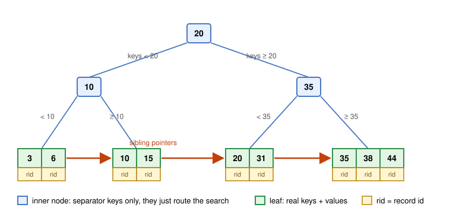
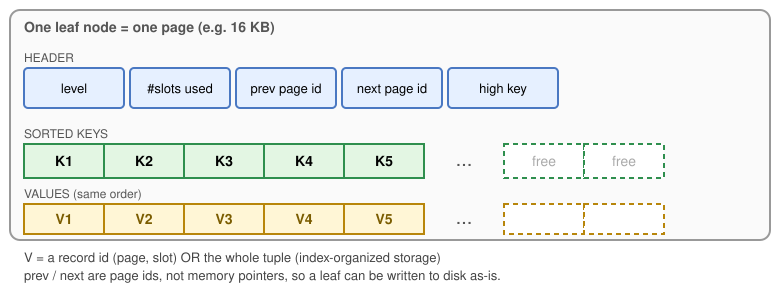
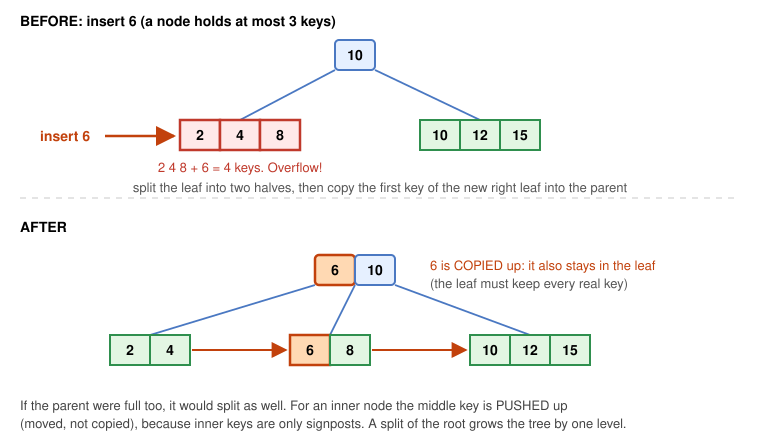
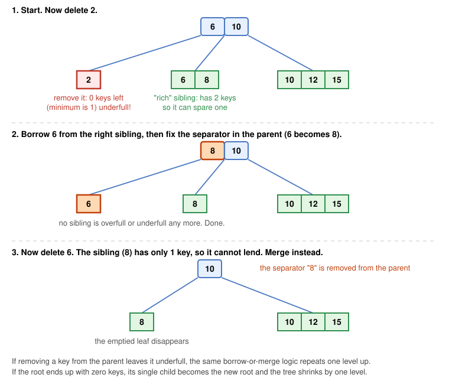
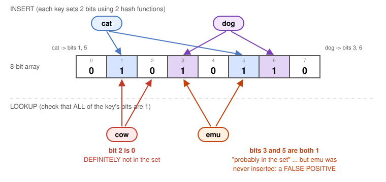
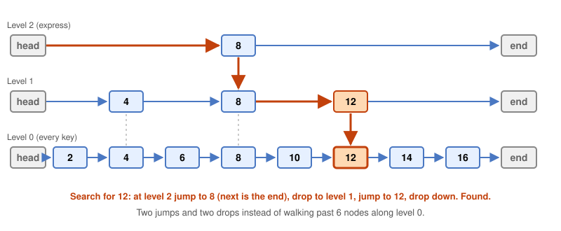
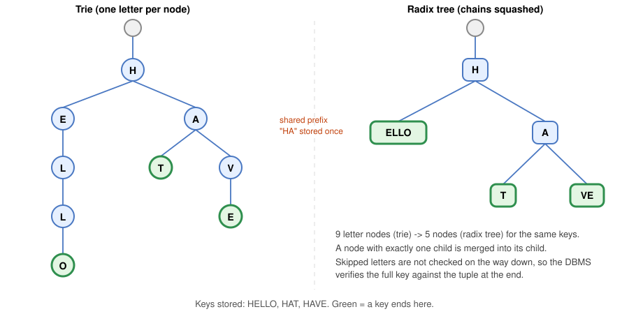
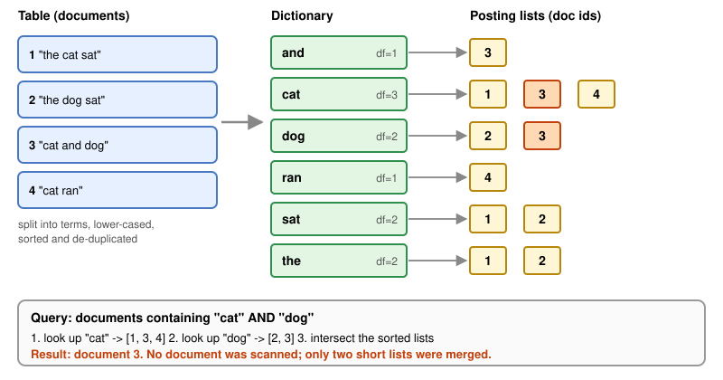
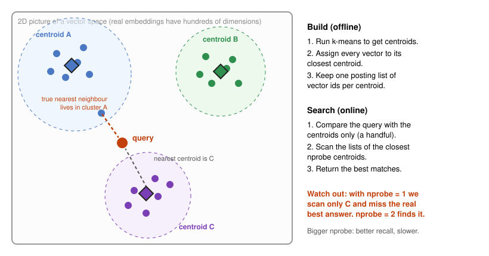
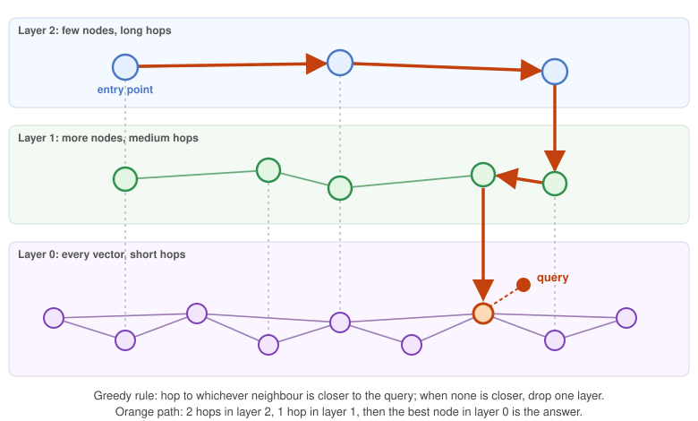

::: {.callout-note appearance="simple"}
**Slides this post is based on:** [Lecture 08, Tree Indexes I](https://15445.courses.cs.cmu.edu/fall2025/slides/08-indexes1.pdf) and [Lecture 09, Tree Indexes II](https://15445.courses.cs.cmu.edu/fall2025/slides/09-indexes2.pdf) from CMU 15-445/645 (Prof. Andy Pavlo).

The ideas come from those slides. The diagrams, examples and analogies are my own, so any mistakes are mine.
:::

## The problem in one sentence

You have a table with a billion rows and a query that wants **one** of them. Reading every row is a non-starter. An **index** is a second, smaller, carefully organized structure that tells the database *where* to look.

In the [previous post](../buffer-pool/index.qmd) we met the buffer pool: a cache of disk pages in memory. Indexes live on top of that. Every node of an index is a page, and every step of a lookup is "ask the buffer pool for that page." So the real goal of a good index is simple: **touch as few pages as possible**.

The mental model I will use throughout is the back-of-the-book index. If you want every page that mentions "buffer pool", you do not read the whole book. You flip to the index, find the word, and jump to the page numbers. Different books (and different questions) need different kinds of index, and that is what this post is about.

Here is the map of what we will cover:

| Question you are asking | Structure that answers it | Section |
|---|---|---|
| "Give me key = 42, or all keys between 10 and 99" | **B+Tree** | [B+Trees](#the-b-tree) |
| "Is this key even in the set?" (cheap yes/no) | **Bloom filter** | [Filters](#bloom-filters-and-other-filters) |
| "Ordered keys, in memory, easy concurrency" | **Skip list** | [Skip lists](#skip-lists) |
| "Keys that share prefixes (strings, bit patterns)" | **Trie / radix tree** | [Tries](#tries-and-radix-trees) |
| "Which documents contain the word X?" | **Inverted index** | [Inverted indexes](#inverted-indexes) |
| "Which items are *similar* to this one?" | **Vector index** | [Vector indexes](#vector-indexes) |

## Indexes vs. filters

The lecture draws a line that is easy to miss:

| | Index | Filter |
|---|---|---|
| Answers | "Where is the tuple with this key?" | "Is this key (probably) in the set?" |
| Returns | A location (record id) | Yes / no |
| Example | B+Tree | Bloom filter |

An index leads you to the data. A filter only tells you whether going to look is worthwhile.


## The B+Tree {#the-b-tree}

### Intuition

Picture a big library. You do not search every shelf. A sign at the entrance says "Fiction left, Science right". Inside Science, another sign says "A to M this aisle". At the end of the aisle the shelf is labelled and the books are *in order*, with each shelf continuing into the next.

A **B+Tree** is exactly that: a few levels of signs, then sorted data at the bottom, with shelves linked left to right.

The name is a family, by the way: B-Tree (1970), B+Tree (1973), B\*Tree, B-link Tree, B-epsilon Tree, Bw-Tree. People often say "B-Tree" to mean any of them, and nearly every database actually ships a B+Tree.

### The rules

A B+Tree of **fanout** $m$ is a self-balancing, ordered, $m$-way tree:

- **Perfectly balanced.** Every leaf is at the same depth, so every lookup costs the same number of page reads.
- **Half-full rule.** Every node except the root holds at least $\lceil m/2 \rceil - 1$ keys and at most $m - 1$ keys.
- **Fanout rule.** An inner node with $k$ keys has exactly $k + 1$ children.
- **Ordered.** Keys inside a node are sorted, so you can binary-search them.
- **Logarithmic.** Search, insert and delete cost $O(\log_m n)$.

A tiny example to keep in mind: with $m = 4$, a node holds 1 to 3 keys (the root may hold fewer). The figures below use that setting.

### Anatomy

{#fig-btree fig-alt="A three-level B+Tree with root key 20, inner keys 10 and 35, and four leaf nodes linked left to right by sibling pointers."}

Read @fig-btree top to bottom:

- The **root** key `20` splits the world in two: keys below 20 go left, keys at or above 20 go right.
- **Inner nodes** repeat the idea: `10` splits the left half, `35` splits the right half.
- **Leaf nodes** hold the actual keys and, beside each key, a value.
- The orange arrows are **sibling pointers**. They are what make range scans cheap (more on that in a moment).

Inside each node, the layout is an array of keys with an array of "next steps": an inner node holds `<child page> | key | <child page> | key | ...` while a leaf holds `key | value | key | value | ...`.

{#fig-leaf fig-alt="A page divided into a header with five fields, an array of sorted keys K1 to Kn and an array of values V1 to Vn."}

Two details are worth noticing in @fig-leaf:

- The links are **page ids**, not memory addresses. The node has to be writable to disk verbatim, so it cannot contain raw pointers. (We will come back to this under "pointer swizzling".)
- `NULL` keys are usually all parked in the first or last leaf, so they do not confuse comparisons.

### What is the "value" in a leaf?

Two common answers:

| Approach | What the leaf stores | Notes |
|---|---|---|
| **Record id** | A pointer to the tuple: `(page id, slot)` | The most common design. The index is separate from the table. |
| **Tuple data** | The whole row | This is *index-organized storage*. For the primary-key index the leaf **is** the row. Secondary indexes then store the **primary key** as their value. |

With the second approach a lookup through a secondary index is two tree descents: find the primary key in the secondary index, then use it to find the row in the primary index.

### B-Tree vs. B+Tree

The original B-Tree stored keys **and** values in every node, which is more space-efficient because each key appears once. A B+Tree stores values only in leaves; inner nodes are pure signposts.

That sounds like a step backwards, but it pays off: signposts are small, so each inner page fits **many more** of them. A larger fanout means a shorter tree. And putting every key in the leaf level lets you chain leaves together for scans.

### How big is "big"?

Take a 16 KB page. A key plus a child pointer is, say, 16 bytes, so a page could hold about 1,000 entries. Real nodes are not perfectly full. The lecture quotes an average occupancy of about **69%**, so call it 700.

$$
\text{entries reachable} \approx 700^{h}
\quad\Rightarrow\quad
700^{3} \approx 3.4 \times 10^{8},\quad 700^{4} \approx 2.4 \times 10^{11}
$$

Three levels already index a third of a **billion** keys; four levels cover a couple of hundred billion. The root and the next level are hit by every query, so they live permanently in the buffer pool. In practice a lookup on a huge table costs about **one disk read**: the leaf.

### Lookups and range scans

Let us trace @fig-btree.

**Point lookup: find `31`.**

1. Root `[20]`: `31 >= 20`, go right.
2. Inner `[35]`: `31 < 35`, go left.
3. Leaf `[20, 31]`: binary-search, found `31`. Follow its value to the tuple.

Three pages. That is the cost whether the table has 100 rows or 100 million.

**Range scan: `WHERE key BETWEEN 10 AND 35`.**

1. Descend to the leaf that would contain `10`: leaf `[10, 15]`.
2. Read `10`, `15`. Hit the end of the leaf, so **follow the sibling pointer** to `[20, 31]`.
3. Read `20`, `31`, follow the pointer to `[35, 38, 44]`.
4. `35` is in range, `38` is not. Stop.

No re-descending from the root, no sorting. That is the entire reason leaves are linked.

### Insert

The recipe is short:

1. Descend to the correct leaf $L$.
2. Insert the key into $L$ in sorted position.
3. If $L$ still has room, done.
4. Otherwise **split** $L$: spread its entries over $L$ and a new node $L_2$, and add an entry for $L_2$ to the parent.

```{mermaid}
%%| fig-cap: "B+Tree insert."
flowchart TD
    A["Descend to the target leaf"] --> B{"Room in the leaf?"}
    B -- "yes" --> C["Insert in sorted order. Done."]
    B -- "no" --> D["Split leaf into two halves"]
    D --> E["COPY the first key of the right half up to the parent"]
    E --> F{"Room in the parent?"}
    F -- "yes" --> G["Done."]
    F -- "no" --> H["Split the inner node. PUSH the middle key up"]
    H --> I{"Was it the root?"}
    I -- "no" --> F
    I -- "yes" --> J["Create a new root. Tree grows by one level."]
```

{#fig-insert fig-alt="Before and after diagrams of a B+Tree. A full leaf holding 2 4 8 receives key 6, splits into 2 4 and 6 8, and key 6 is copied into the parent."}

In @fig-insert the leaf `[2, 4, 8]` is full (max 3 keys), so inserting 6 would make four. We split into `[2, 4]` and `[6, 8]`, and the parent gains the signpost `6`: "keys from 6 up are in the new right leaf."

#### Copy up vs. push up

This is the subtle bit that trips people up:

| Splitting | What happens to the middle key |
|---|---|
| **Leaf** | **Copied** up. It must remain in the leaf, because the leaf has to contain every real key. |
| **Inner node** | **Pushed** up (moved). Inner keys are only signposts, so keeping a duplicate one level down would be pointless. |

#### When the tree grows

If the split cascades all the way up and the root itself is full, the root splits and a **new root** with a single key is created above it. The height goes up by one, and every leaf is still at the same depth. This is why a B+Tree stays balanced for free: it only ever grows from the **top**, never from the bottom.

### Delete

Deletion is insertion in reverse:

1. Descend to the leaf, remove the entry.
2. If the leaf is still at least half full, done.
3. Otherwise it is **underfull**. First try to **borrow** an entry from a sibling (same parent) that has one to spare.
4. If no sibling can spare one, **merge** the leaf with a sibling and remove the separator from the parent.
5. The parent lost a key, so it may now be underfull, and the process repeats upward.

```{mermaid}
%%| fig-cap: "B+Tree delete."
flowchart TD
    A["Find the leaf, remove the entry"] --> B{"At least half full?"}
    B -- "yes" --> C["Done."]
    B -- "no" --> D{"Sibling has a spare key?"}
    D -- "yes" --> E["Borrow it. Update the separator in the parent. Done."]
    D -- "no" --> F["Merge with the sibling"]
    F --> G["Remove the separator from the parent"]
    G --> H{"Parent underfull?"}
    H -- "yes" --> D
    H -- "no" --> I["Done."]
```

{#fig-delete fig-alt="Three stacked B+Tree diagrams. Panel 1 shows a leaf that becomes empty. Panel 2 shows it borrowing key 6 from its sibling. Panel 3 shows two leaves merging and a separator disappearing from the parent."}

Walk through @fig-delete:

1. Deleting `2` empties its leaf, which violates "at least 1 key". The right sibling `[6, 8]` has two keys, so it can lend one.
2. We borrow `6`. The leaf is now `[6]`, the sibling is `[8]`, and the parent's separator is updated from `6` to `8` so it still describes the boundary correctly.
3. Later, deleting `6` empties the leaf again. This time the sibling `[8]` has exactly the minimum, so it cannot lend. We **merge** and delete the separator from the parent.

If merges cascade up to the root and the root is left with zero keys, its single remaining child becomes the new root, and the tree **shrinks** one level. Growing and shrinking both happen at the top, which keeps the leaves level.

### Composite (multi-column) indexes

An index can be on several columns, such as `(a, b, c)`. The key is the *tuple* of those values, compared left to right, like sorting a phone book by last name, then first name, then middle name.

```sql
CREATE INDEX my_idx ON t (a, b DESC, c NULLS FIRST);
```

The ordering you declare (ASC/DESC, where NULLs go) is baked into the tree. The golden rule is the **prefix rule**: the index helps only if the query constrains a *leading* prefix of the columns.

| Query on index `(a, b, c)` | Can the tree navigate with it? |
|---|---|
| `a = 1 AND b = 2 AND c = 3` | Yes, full key |
| `a = 1 AND b = 2` | Yes, prefix `(a, b)` |
| `a = 1` | Yes, prefix `(a)` |
| `a = 1 AND c = 3` | Partly: navigates by `a`, then `c` must be filtered afterwards |
| `b = 2` | Generally no (the lecture says rarely supported) |
| `c = 3` | Generally no |

Why does `b = 2` fail? Look at the sorted keys of a two-column index `(a, b)`:

```
(1,1) (1,2) (1,3) | (2,1) (2,2) (2,3) | (3,1) (3,3) | (4,1)
```

All entries with `b = 1` are `(1,1) (2,1) (3,1) (4,1)`: **scattered** across the whole tree. There is no contiguous range to jump to, so the DBMS cannot use the sort order. The phone-book version: you cannot look up everyone named "Priya" without knowing the last name.

The same logic means **column order matters**. Put the column you filter by equality most often first.

### Duplicate keys

What if you build a non-unique index and many rows share a key? Two approaches:

| Approach | How | Trade-off |
|---|---|---|
| **Append the record id** | Make the key `(key, rid)`. Now every key is unique. Searches by the original key still work as a prefix search. | Simple, widely used. |
| **Overflow leaf nodes** | When a leaf cannot hold all copies of a key, chain extra overflow pages. | More complex to maintain and modify. The lecture's advice is "don't do this." |

There is also an optimization where a leaf stores each key once with a list of values (*deduplication*), which we will see later.

### Clustered indexes and why page order matters

A **clustered index** means the table's rows are physically stored in primary-key order. Some systems (MySQL InnoDB, for example) always cluster; if you declare no primary key they invent a hidden one. Others cannot cluster at all.

The payoff is for scans. `SELECT * FROM t ORDER BY pk` becomes: walk to the leftmost leaf and follow the sibling chain. The data is already sorted on disk, so this beats sorting at query time every time.

A **non-clustered** index is where it gets ugly. The index returns record ids in key order, but the rows they point to are scattered over many pages. Suppose the index yields tuples living on pages:

```
102, 103, 102, 104, 103, 101, 104
```

Fetching in that order may re-read pages (if they were evicted in between). The smarter approach is **index scan page sorting**: collect all the record ids the query needs first, sort them by page id, then fetch:

```
101, 102, 102, 103, 103, 104, 104   -> each page is read exactly once
```

You give up the key order of the output (the optimizer will re-sort if the query demands it) in exchange for far fewer page reads.

## B+Tree design choices

The rules above leave room for real engineering decisions.

### Node size

The slower the storage, the **larger** the node should be. Slow devices reward big sequential reads, so amortize the cost over many keys.

| Storage | Rough optimal node size |
|---|---|
| Spinning disk (HDD) | ~1 MB |
| SSD | ~10 KB |
| In-memory | ~512 B |

The "right" number also depends on workload: large leaves favour long scans, small nodes favour root-to-leaf probes.

### Merge threshold

Strictly following "merge at half full" can cause thrashing: a node that just merged may split again on the next insert. Many systems **delay** merging and let nodes stay underfull for a while, rebuilding the whole index occasionally. PostgreSQL's B+Tree (`nbtree`) is the standard example: it is lazy about reorganizing, which is why the lecture jokes it is a "non-balanced" B+Tree. The measured average node occupancy of around 69% is partly a consequence of this.

### Variable-length keys

Strings and other variable-size keys break the clean "array of fixed slots" picture. Four options:

| Approach | Idea | Cost |
|---|---|---|
| **Pointers** | Store the key as a pointer to the real value in the tuple | Extra memory jump per comparison; bad for caches |
| **Variable-length nodes** | Let node sizes vary | Tricky memory management |
| **Padding** | Pad every key to the maximum length | Wastes space |
| **Key map / indirection** | Keep a small array of offsets pointing to keys packed inside the node | The common practical choice |

### Searching inside a node

Once a page is in memory you still must find the key *within* it:

- **Linear scan.** Compare from the start. Sounds slow, but with **SIMD** you compare many keys per instruction (e.g. checking 4 or 8 integers at once), so for small nodes it is very competitive.
- **Binary search.** Jump to the middle, go left or right. $O(\log_2 k)$ comparisons.
- **Interpolation.** If keys are roughly evenly spread, *guess* where the key sits, like opening a dictionary near the back when you look up "zebra." For a sorted array with $n$ keys between `min` and `max`:

$$
\text{position} \approx \frac{\text{target} - \text{min}}{\text{max} - \text{min}} \times (n - 1)
$$

Example: keys `4 5 6 7 8 9 10`, looking for `8`: $\frac{8 - 4}{10 - 4} \times 6 = 4$, so jump straight to index 4. It only works well for fairly uniform data.

## B+Tree optimizations

### Pointer swizzling

Nodes refer to their children by **page id**. Every hop requires the DBMS to look the page id up in the buffer pool's page table to get a memory address. If a page is **pinned** in memory (the root and top levels, say), we can store the raw memory pointer in the parent instead and skip the lookup entirely. The cost is bookkeeping: a swizzled pointer is only valid while the page stays in memory, so the DBMS must unswizzle when evicting. This is a direct tie-in to the [buffer pool post](../buffer-pool/index.qmd).

### Buffered updates (write-optimized trees)

Splits and merges are expensive, and the unlucky writer who triggers one pays for it. What if updates could be **batched**?

In a **B-epsilon tree** (also called a *fractal tree*), every inner node has a small **log buffer**. Instead of walking down to the leaf, an insert or delete is appended to the root's buffer. When a buffer fills up, its messages are flushed one level down, in bulk, and so on. Many changes share one trip down the tree. A lookup must check the buffers on the way down, because the newest value for a key might still be sitting in one.

The trade is classic: faster writes, slightly slower reads.

### Partial indexes

Index only a **subset** of the rows. The index is smaller, cheaper to maintain, and still useful if your queries target that subset:

```sql
CREATE INDEX idx_foo ON foo (a, b) WHERE c = 'WuTang';

-- Can use the partial index:
SELECT b FROM foo WHERE a = 123 AND c = 'WuTang';
```

A common use is one index per time range (per month or per year), so old, rarely queried data does not bloat the hot index.

### Included columns (covering indexes)

Sometimes the query needs a column that is not part of the search key. You can **include** it as extra payload in the leaf only:

```sql
CREATE INDEX idx_foo ON foo (a, b) INCLUDE (c);

SELECT b FROM foo WHERE a = 123 AND c = 'WuTang';
```

Here `c` is not used to navigate, but it is stored in the leaf. If *every* column the query needs is in the index, the DBMS never touches the table: an **index-only scan** (the index is then called a *covering index*). It saves one random page read per row, which is often the dominant cost.

### Prefix compression

Sorted keys in one leaf tend to share beginnings. Store the common prefix once:

```
robbed  robbing  robot      ->   prefix "rob" + suffixes: bed  bing  ot
```

### Deduplication

For non-unique indexes, avoid storing the same key over and over. Store it once with a **posting list** of values:

```
K1 V1 | K1 V2 | K1 V3 | K2 V4     ->     K1 -> [V1, V2, V3] | K2 -> [V4]
```

### Suffix truncation

Inner-node keys only need to be long enough to **direct traffic**. If the left subtree ends at `abcdefghijk` and the right begins at `lmnopqrstuv`, the separator can be just `lmn` (even `l` suffices here). Shorter separators mean more of them per page, which means higher fanout, a shorter tree and fewer page reads.

### Bulk insert

Building an index on an existing table by inserting rows one at a time does a descent and possibly a split for every row. A far faster approach is to **sort the keys first and build bottom-up**:

```
keys:    3  7  9  13  6  1
sorted:  1  3  6  7   9  13

leaf level:     [1 3 6]   [7 9 13]       <- fill leaves left to right, link them
parent level:        [7]                 <- one separator per boundary
```

No splits, no descents, and the leaves come out tightly packed and sequential on disk.

## Beyond the B+Tree

Lecture 09 tackles a different question: what about workloads a B+Tree is *not* good at? Four of them appear below: cheap existence checks, in-memory ordered data, prefix-heavy keys, and searching by content or meaning rather than by value.

### Bloom filters and other filters {#bloom-filters-and-other-filters}

**The problem.** In a B+Tree, even asking "does key X exist?" costs a full descent to the leaf, potentially one buffer pool miss per level. If the answer is often "no", that is wasted I/O.

**The idea.** A **Bloom filter** is a tiny bit array plus $k$ hash functions. It can say "definitely not present" or "probably present".

- **Insert**$(x)$: hash $x$ with each of the $k$ functions and set those bits to 1.
- **Lookup**$(x)$: hash the same way. If **any** of those bits is 0, $x$ was **never** inserted. If **all** are 1, it is *probably* present.

{#fig-bloom fig-alt="An 8-bit array with inserts for cat and dog setting bits 1,5 and 3,6. A lookup for cow finds bit 2 is zero. A lookup for emu finds bits 3 and 5 both set, a false positive."}

Look at @fig-bloom carefully:

- **No false negatives, ever.** If a key was inserted, all its bits are 1, so the lookup says "maybe." The filter cannot forget.
- **False positives are possible.** `emu` was never inserted, but `dog` set bit 3 and `cat` set bit 5. The filter cannot tell whose bits they are.

The false positive rate depends on the number of bits $m$, the number of inserted keys $n$ and the number of hash functions $k$:

$$
p \approx \left(1 - e^{-kn/m}\right)^{k}
$$

Give it more bits per key and the rate drops fast. About 10 bits per key with a good choice of $k$ gets you near 1%. Crucially, the filter is small enough to sit in memory, so a "definitely not" answer saves a disk trip altogether.

**Cousins.**

| Filter | What it adds |
|---|---|
| **Counting Bloom filter** | Uses small counters instead of bits, so keys can be **deleted** (decrement) |
| **Cuckoo filter** | Built on cuckoo hashing, stores small *fingerprints*; supports insert and delete |
| **SuRF (Succinct Range Filter)** | A compact immutable trie; answers **range** as well as point membership |

### Skip lists

**The problem.** The simplest ordered structure is a sorted linked list. It is easy to update, but search is $O(n)$: you walk the whole thing.

**The analogy.** Think of a metro with **express** and **local** trains. The local train stops at every station, the express only at a few. To go far you ride the express, then switch to the local near your destination.

A **skip list** is a sorted linked list with extra "express lanes" stacked above it:

- Level 0: every key, linked in order.
- Level 1: roughly every other key.
- Level 2: roughly every fourth key, and so on. Each level has about half the keys of the one below.

{#fig-skip fig-alt="Three horizontal linked lists stacked vertically. The bottom has keys 2 through 16, the middle has 4, 8, 12 and the top has 8. An orange path shows the search for 12."}

**Search.** Start at the top-left. At each level go right while the next key is not larger than the target; when it would overshoot, drop down one level. This costs about $O(\log n)$ on average, like a balanced tree.

**Insert.** Find the position on level 0 and insert there. Then **flip a coin** repeatedly to decide how many levels the new node also joins: heads, add it to the next level up; tails, stop. This randomness keeps the level sizes roughly halving without any rebalancing, which is the beauty of the structure: **no global rebalancing, no node splitting**.

**Delete.** Done in two phases: first *logically* delete by setting a flag on the node so that other threads skip it; later, physically unlink it once nobody could still hold a reference. This two-step approach is what makes lock-free implementations practical.

| Pros | Cons |
|---|---|
| Simple; inserts and deletes touch only a few pointers | **Not cache or disk friendly**: nodes are scattered, no locality |
| No rebalancing | Reverse traversal is awkward (needs extra back pointers) |
| Easy to make concurrent | Each node carries several pointers, a memory cost |

Because of the locality problem, skip lists are used mainly **in memory**. A well-known use is the *memtable* of LSM-tree storage engines, where recent writes are kept sorted in a skip list before being flushed to disk.

### Tries and radix trees

**The observation.** A B+Tree's inner keys cannot tell you whether a key **exists**. You must always go to the leaf. A **trie** (prefix tree, digital search tree) works differently: instead of comparing whole keys, it walks the key **piece by piece**.

{#fig-trie fig-alt="Left: a trie with one letter per node. Right: a radix tree in which chains like E-L-L-O are collapsed into a single node ELLO."}

Properties of a trie:

- The **path** from the root spells the key. The key is never stored whole: it is reconstructed from the path.
- The **shape** depends only on the keys themselves, not on insertion order. So there is **no rebalancing**.
- Cost is $O(k)$, where $k$ is the **key length**, regardless of how many keys are stored. (Compare to $O(\log n)$ for a B+Tree.)
- Shared prefixes (like `HA` above) are stored once.

**Key span.** Real tries do not go one *letter* at a time but one fixed-size **digit** at a time. The *span* is how many bits each level consumes.

| Span | Fan-out per node | Levels for a 16-bit key | Trade-off |
|---|---|---|---|
| 1 bit | 2 | 16 | Tiny nodes, very tall tree, slow |
| 8 bits | 256 | 2 | Short tree, but a 256-slot node is wasteful if only a few children exist |

**Radix tree (Patricia tree).** A *vertically compressed* trie: whenever a node has only one child, merge it into that child, so edges carry multi-character labels (@fig-trie, right). This saves a lot of space on sparse keys. The catch: since skipped characters are not checked on the way down, a lookup can land on the wrong leaf. The DBMS therefore **verifies the full key** against the tuple at the end.

**Modifications.** Insert `HAIR` into the radix tree: the `A` node gets a new child `IR`. Delete `HAT`: its leaf disappears, and if that leaves a node with a single child, it is merged back into it (the compression is maintained).

**Famous variants.**

| Variant | Where | Idea |
|---|---|---|
| **Judy arrays** | HP | 256-way radix tree with adaptive node representations |
| **ART (Adaptive Radix Tree)** | HyPer | 256-way radix tree whose node type adapts to how many children it has |
| **Masstree** | Silo | A B+Tree whose *inside* of each node is a trie |
| **SuRF** | CMU | A compressed static trie that is also a range filter |

### Inverted indexes

**The problem.** B+Trees answer "key = X" and "key between X and Y". They are bad at **content search**:

```sql
SELECT pageID FROM revisions WHERE content LIKE '%Pavlo%';
```

A B+Tree is sorted by the *beginning* of the value. A word in the *middle* of a paragraph gives it nothing to navigate by, so the DBMS must scan every row.

**The analogy.** The index at the back of a textbook. Instead of "page 17 contains these words" (a forward map), it stores "this word appears on pages 17, 42, 88" (an **inverted** map). The idea is old: it was originally called a *concordance*, in use since the 1200s.

{#fig-inverted fig-alt="Four documents on the left, a sorted dictionary of terms in the middle, and posting lists of document ids on the right. A query for cat AND dog intersects the lists for cat and dog to get document 3."}

It has two parts:

- A **dictionary**: the sorted set of all terms (with, e.g., the document frequency $df$).
- A **posting list** for each term: the sorted ids of records containing it (often with positions and counts).

`cat AND dog` is just an **intersection** of two sorted lists, a linear merge. `cat OR dog` is a union.

**Real implementations.**

- **Lucene** (the engine inside Elasticsearch and Solr). The dictionary is stored as a **finite state transducer (FST)**, like a trie that shares both prefixes *and* suffixes and maps a term to its offset, so it is extremely compact. The index is built as many small **immutable segments**, merged in the background. Posting lists use compression (delta encoding, bit packing) and can carry pre-computed stats.
- **PostgreSQL GIN** (Generalized Inverted Index). The dictionary is a **B+Tree**. A term with few matches keeps a sorted list of record ids; a term with *many* matches gets its own **B+Tree of record ids** (a posting tree). Updates are expensive to apply one at a time, so GIN first appends them to a **pending list** and merges in batches.

**Beyond exact words.**

- **Ranking.** Return the *best* matches first. The classic score is TF-IDF: a term is important in a document if it appears often there (term frequency) but rarely across the corpus (inverse document frequency):

$$
\text{tfidf}(t, d) = \text{tf}(t, d) \times \log\frac{N}{\text{df}(t)}
$$

  BM25 refines this (it saturates the benefit of repeating a word and accounts for document length) and is the default in many search engines.

- **Tokenizers and n-grams.** To support typos and autocomplete, split terms into overlapping fragments. The word `database` becomes the trigrams `dat`, `ata`, `tab`, `aba`, `bas`, `ase`. Now a misspelling like `databse` still shares most trigrams, so it still matches. (PostgreSQL's `pg_trgm` and Elasticsearch's n-gram tokenizer do exactly this.)
- **Normalization.** Lower-casing and punctuation handling so that `Wu-Tang` matches `Wu Tang`.

### Vector indexes

**The problem.** Inverted indexes match **words**. But sometimes you want **meaning**: "find albums with lyrics about running from the police," even if none of them contains those exact words.

**How it works.**

1. A neural network (a transformer) turns each row's text into an **embedding**: a long array of floating-point numbers (hundreds to thousands of dimensions). Texts with similar meaning land **close together** in this space.
2. At query time the query text is embedded by the same model.
3. The database finds the stored embeddings **nearest** to the query vector (by cosine or Euclidean distance) and returns their ids.

Queries often mix this with ordinary filters ("...and released after 2005"), so the DBMS has to decide whether to filter *before* or *after* the vector search. Also notice that the answer is *approximate*: correctness here means the result "feels right" rather than being exactly the true top-k. The quality is measured by **recall**: what fraction of the true nearest neighbours were found.

Exact nearest-neighbour search in hundreds of dimensions is hopeless to do faster than a full scan, so vector indexes trade a little accuracy for large speed-ups. Two families:

#### Approach 1: inverted-file (IVF) indexes

Partition the space into clusters, then only search the relevant ones. This is the same trick as the inverted index, with *cluster centroids* playing the role of words.

{#fig-ivf fig-alt="A scatter plot of points in three coloured clusters with centroids. A query point is closest to the purple centroid, but its true nearest neighbour belongs to the blue cluster."}

1. **Build:** run **k-means** to find $k$ centroids; assign every vector to the nearest centroid; build an inverted index `centroid -> list of vectors`.
2. **Search:** find the nearest centroid(s) to the query; scan only those lists.

@fig-ivf shows the central weakness: points near a cluster boundary. The query's closest *centroid* is C, but its closest *vector* lives in A. The fix is to probe several nearby clusters (`nprobe`): more recall, more work. Vectors are often compressed ("quantized") to make the scans cheaper. IVFFlat in the `pgvector` extension is a well-known implementation.

#### Approach 2: graph indexes

Build a **graph** where every vector is a node connected to its (approximately) nearest neighbours. To search, start somewhere and **greedily walk** to whichever neighbour is closer to the query until no neighbour is closer. It is like finding a friend in a crowd by asking each person "who do you know that is closer to them?"

The best-known variant is **HNSW** (Hierarchical Navigable Small World), which stacks several graph layers:

{#fig-hnsw fig-alt="Three layers of graphs. The top has three nodes, the middle five, the bottom has every node. An orange path goes across the top layer, down, one hop in the middle layer, and down to the closest bottom-layer node."}

It is the same idea as the skip list from earlier: **express lanes** (sparse top layers) get you to the right neighbourhood quickly, and the dense bottom layer finishes the job. Implementations include Faiss, hnswlib and DiskANN (designed for graphs that do not fit in memory).

| | IVF | Graph (HNSW) |
|---|---|---|
| Idea | Cluster, then scan clusters | Walk a neighbour graph |
| Updates | Easier (add to a list) | Harder (rewire edges) |
| Speed/recall | Good; tuned via `nprobe` | Typically better at the same recall |
| Memory | Smaller | Larger (stores edges) |

(The last two rows are general rules of thumb, not from the slides.)

## Which index should I use?

```{mermaid}
%%| fig-cap: "A rough guide to choosing an index."
flowchart TD
    A["What does the query ask?"] --> B{"Exact key or a range?"}
    B -- "yes" --> C["B+Tree (the default)"]
    B -- "exact key only, never ranges" --> C2["Hash index"]
    A --> D{"Is this key in the set at all?"}
    D -- "yes" --> E["Bloom / cuckoo filter in front of the real lookup"]
    A --> F{"Words inside text?"}
    F -- "yes" --> G["Inverted index"]
    A --> H{"Similar by meaning?"}
    H -- "yes" --> I["Vector index (IVF or HNSW)"]
    A --> J{"In-memory ordered data with high concurrency?"}
    J -- "yes" --> K["Skip list"]
    A --> L{"Long, prefix-sharing keys?"}
    L -- "yes" --> M["Trie / radix tree (e.g. ART)"]
```

## The big picture

The lecture's conclusion is blunt: **the B+Tree is (almost) always a good choice.** It is balanced, ordered, disk-friendly, handles range scans and has decades of engineering behind it. The other structures are specialists for narrower jobs.

| Structure | Core idea | Best at | Weak at |
|---|---|---|---|
| **B+Tree** | Balanced tree, data in linked leaves | Point + range + ordered scans | Non-prefix content search |
| Bloom filter | Bit array + $k$ hashes | Cheap "definitely not" | Deletes, locating data |
| Skip list | Linked lists with express lanes | In-memory ordered data, easy concurrency | Disk, cache locality |
| Trie / radix tree | Walk the key piece by piece | Prefix keys, $O(k)$ lookup | Memory if sparse (hence radix/ART) |
| Inverted index | Term to list of records | Keyword / full-text search | Range queries, similarity |
| Vector index | Nearest neighbours of embeddings | "Find similar" queries | Exactness |

And a few ideas recur across all of them, which I found the most useful takeaway:

- **Hierarchy to skip work.** B+Tree levels, skip-list lanes and HNSW layers are all the same trick: take big steps first, small steps last.
- **Trade exactness for speed** where the application allows it: Bloom filters (false positives) and vector indexes (approximate recall).
- **Batch to amortize cost**: bulk loading, B-epsilon buffers and GIN's pending list.
- **Everything is paged.** Fanout, node size and pointer swizzling all come down to "how few pages does a lookup touch?"

## Where to go next

The next lecture is the one I am most curious about: **how to make these indexes thread-safe**. Everything above assumed one thread at a time. Real systems have many threads splitting, merging and scanning the same tree simultaneously, which is where latches (from the buffer pool post) come back in.


## References

- **Slides:** [Lecture 08, Tree Indexes I](https://15445.courses.cs.cmu.edu/fall2025/slides/08-indexes1.pdf) and [Lecture 09, Tree Indexes II](https://15445.courses.cs.cmu.edu/fall2025/slides/09-indexes2.pdf), CMU 15-445/645 Fall 2025, Prof. Andy Pavlo.
- **Course website:** [15445.courses.cs.cmu.edu](https://15445.courses.cs.cmu.edu/)
- Bayer, McCreight. *Organization and Maintenance of Large Ordered Indices.* 1970 (the B-Tree).
- Pugh. *Skip Lists: A Probabilistic Alternative to Balanced Trees.* CACM 1990.
- Bloom. *Space/Time Trade-offs in Hash Coding with Allowable Errors.* CACM 1970.
- Leis, Kemper, Neumann. *The Adaptive Radix Tree: ARTful Indexing for Main-Memory Databases.* ICDE 2013.
- Malkov, Yashunin. *Efficient and Robust Approximate Nearest Neighbor Search Using Hierarchical Navigable Small World Graphs.* 2016.
