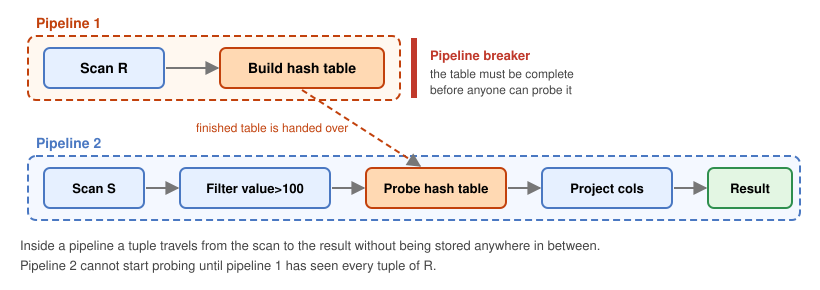
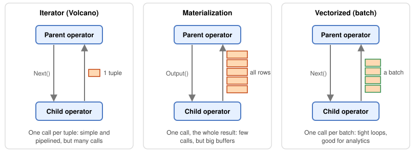
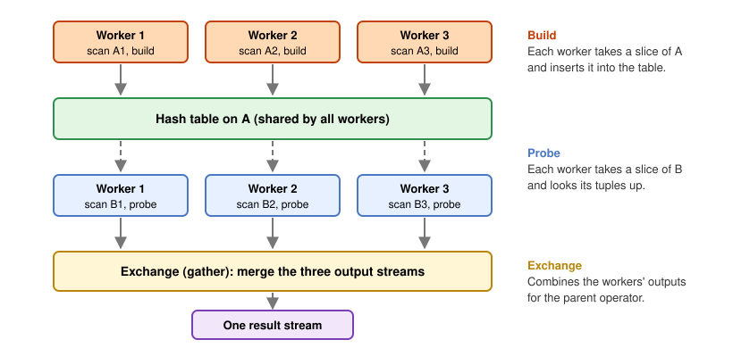
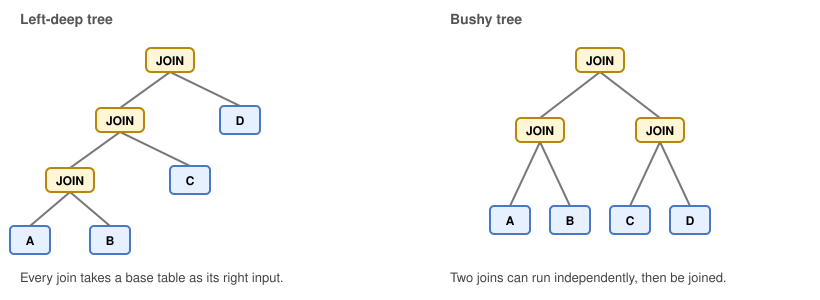
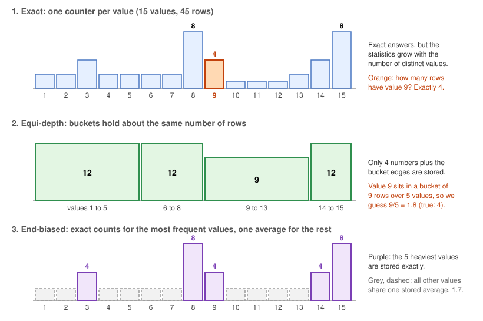

::: {.callout-note appearance="simple"}
**Slides this post is based on:** [Query Execution I](https://15445.courses.cs.cmu.edu/fall2025/slides/13-queryexecution1.pdf), [Query Execution II](https://15445.courses.cs.cmu.edu/fall2025/slides/14-queryexecution2.pdf), [Query Optimization I](https://15445.courses.cs.cmu.edu/fall2025/slides/15-optimization1.pdf) and [Query Optimization II](https://15445.courses.cs.cmu.edu/fall2025/slides/16-optimization2.pdf) from CMU 15-445/645 (Prof. Andy Pavlo).

The ideas come from those slides. The diagrams, examples and analogies are my own, so any mistakes are mine. The post has three parts: **executing a plan**, **executing it in parallel**, and **choosing the plan** (optimization).
:::

## Where we are in the stack

Earlier posts covered the [buffer pool](../buffer-pool/index.qmd), [indexes](../indexes/index.qmd), and the algorithms for [sorting, aggregation and joins](../sorting-aggregations-joins/index.qmd). Those are the *parts*. This post is about the *machine that uses them*:

1. **Executing** a plan: how operators pass data to each other, and how a scan or an expression is evaluated.
2. **Parallelism**: how to use many cores and many disks for one query.
3. **Optimizing**: how the database chooses *which* plan to run out of a huge number of equivalent ones.

Here is the whole journey of a SQL string:

```{mermaid}
%%| fig-cap: "From SQL text to a running plan"
flowchart LR
    Q["SQL query"] --> P["Parser"]
    P --> AST["Abstract syntax tree"]
    AST --> B["Binder"]
    B --> L["Logical plan"]
    L --> O["Optimizer"]
    O --> PP["Physical plan"]
    PP --> E["Execution engine"]
    CAT[("System catalog: names to internal ids, schemas, statistics")] --> B
    CAT --> O
    CM["Cost model"] --> O
```

- The **parser** checks the syntax and builds an abstract syntax tree.
- The **binder** uses the catalog to turn names (`R`, `value`) into internal ids and checks that they exist.
- The **optimizer** turns the *logical* plan (what to compute) into a *physical* plan (which algorithms to use), using a **cost model** fed by statistics.
- The **execution engine** runs the physical plan.

An analogy I like: the optimizer is a GPS and the execution engine is the driver. The GPS can only choose a route from its *map and traffic estimates*. If those are stale, you are going to take a bad road, however well you drive.

# Part 1: Executing a plan

## A plan is a tree of operators

Take a simple query:

```sql
SELECT R.id, S.cdate
  FROM R JOIN S ON R.id = S.id
 WHERE S.value > 100;
```

The plan is a tree: scans at the leaves, a join in the middle, a projection at the top. The DBMS can split it into **pipelines**: stretches of the plan where a tuple can flow from one operator to the next without being stored.

An operator that must see **all** of its input before it can emit anything is a **pipeline breaker**. The usual suspects are the *build side* of a hash join, subqueries that must finish first, and `ORDER BY`.

{#fig-pipelines fig-alt="Two lanes. Pipeline 1 scans R and builds a hash table. Pipeline 2 scans S, filters, probes the hash table, projects and outputs the result."}

@fig-pipelines is the idea to keep in mind for the rest of the post: *inside* a pipeline data streams, *between* pipelines it waits.

## Processing models

A **processing model** defines how operators talk to each other: who asks for data, and how much moves per request. There are three.

### Iterator model (Volcano)

Every operator implements three functions:

- `Open()`: set yourself up (and open your children).
- `Next()`: give me **one** tuple, or "no more".
- `Close()`: clean up.

```python
def Next(self):            # a filter operator
    while True:
        t = self.child.Next()
        if t is None:
            return None    # child is exhausted
        if self.predicate(t):
            return t       # hand exactly one tuple up
```

The root calls `Next()` on its child, which calls `Next()` on *its* child, all the way down to a scan. Think of an **assembly line where the last station pulls one item at a time**. Nothing is stored in between, so pipelines come for free, and the code is simple. That is why nearly every database uses it, in one form or another.

The price: one function call (usually a virtual call) *per tuple, per operator*. On big analytical scans that overhead adds up.

Some operators are naturally **blocking** under this model: a join builds its hash table fully before its first `Next()` result, and `ORDER BY` has to see everything. `LIMIT` is the happy case: it can stop asking for tuples after *n*.

### Materialization model

Each operator processes **all** its input and returns **all** its output at once, as one big result. There is no per-tuple calling overhead; each operator is called once.

This is the *"do the whole stage, then start the next"* approach. It works well for **OLTP**, where queries touch few tuples, so the "all of it" is small. It is bad for big analytical queries because intermediate results can be huge. The slides mention it is used in, for example, MonetDB, and in some systems you can push a `LIMIT` hint into the operator so it does not produce more than needed.

### Vectorized (batch) model

The middle road: like the iterator model, but `Next()` returns a **batch** (say a few hundred or a thousand tuples, often stored column by column) instead of one tuple. Each operator then loops over the batch in a tight loop.

Why this is a good idea:

- Function-call overhead is divided by the batch size.
- Tight loops over arrays keep the CPU's caches and pipelines happy, and allow **SIMD** instructions.
- The batch can carry a *null bitmap* so nulls are handled without branching per value.

This is the standard choice for analytical (OLAP) systems.

{#fig-models fig-alt="Three panels comparing the iterator model (one tuple per call), the materialization model (all rows in one call) and the vectorized model (one batch per call)."}

| Model | Unit per call | Strength | Weakness | Typical use |
|---|---|---|---|---|
| Iterator | 1 tuple | Simple, pipelined, easy `LIMIT` | Many calls, poor CPU efficiency | Most row stores |
| Materialization | All tuples | No per-tuple overhead | Big intermediate results | OLTP, in-memory systems |
| Vectorized | A batch | Fewer calls, SIMD friendly | A bit more bookkeeping | Analytics (OLAP) |

## Pull or push?

There are two directions to drive a plan:

**Pull (top-down).** The root asks its child for data, which asks its child, and so on. This is the iterator model above. `LIMIT` is easy (just stop asking). The cost is control flow bouncing through many calls.

**Push (bottom-up).** The *leaves* drive: each scan reads a tuple and **pushes** it into its parent, which pushes its result to *its* parent. The big win is **fusing** a whole pipeline into one tight loop, so the tuple stays in a CPU register as it goes through several operators:

```python
# push-based, fused pipeline 2 from the example (conceptually)
for s in scan_S:
    if s.value > 100:                    # filter
        for r in hash_table.get(s.id):   # probe
            emit(r.id, s.cdate)          # project
```

That is great for caches and registers. The difficulty is operators that do not fit the pattern well (the slides single out **sort-merge join** as hard in a push world), and the code is harder to reason about. Pushing is also commonly paired with a scheduler that decides which pipeline runs next and where output buffers live.

Both are widely used, but pull is by far the more traditional.

## Access methods

An **access method** is how an operator reads data from a table.

### Sequential scan

For each page, fetch it from the buffer pool and examine every tuple. The slides list the usual ways to make this cheaper:

- **Prefetching**, **scan sharing** (queries share one scan), and **buffer pool bypass** so a big scan does not wipe the cache.
- **Compression / data encoding** so there is less to read.
- **Clustering or sorting** so related data sits together.
- **Late materialization**: carry only column ids and offsets and fetch the other columns only for rows that survive.
- **Materialized views and result caching**.
- **Parallelization**: tasks across threads, and data parallelism (SIMD).
- **Code specialization / compilation** of the scan.
- **Data skipping** (below).

### Data skipping

The cheapest page is the one you do not read. Two flavours:

- **Approximate queries (lossy):** run the query over a sample and accept an approximate answer.
- **Zone maps (lossless):** keep pre-computed summaries per page, and look at the summary before the page.

A zone map for a page containing `100, 200, 300, 400, 400`:

| MIN | MAX | AVG | SUM | COUNT |
|---|---|---|---|---|
| 100 | 400 | 280 | 1400 | 5 |

For `SELECT * FROM table WHERE val > 600`, the MAX is 400, so the entire page is skipped without being read. As a bonus, some aggregates (like `SUM` or `COUNT` over a whole page) can be answered directly from the zone map.

### Index scan

If an index covers the predicate, you can use it instead of scanning. But *which* index, and *whether at all*, depends on **the data**, not on the query text. Take

```sql
SELECT * FROM students
 WHERE age < 30 AND dept = 'CS' AND country = 'US';
```

with indexes on `age` and on `dept`:

- Scenario A: 99 students are under 30, but only 2 are in CS. The `dept` index returns 2 candidates, so use it and check `age` on those.
- Scenario B: 2 students are under 30, but 99 are in CS. Now the `age` index is the better start.

The same query, different best plan. That is the entire reason an optimizer needs statistics.

### Multi-index scan

If several indexes each help, use **all** of them. Each index returns a *set of record ids*, then the sets are combined: **intersection** for `AND`, **union** for `OR`, using bitmaps or hash tables. Only then are records fetched, and the leftover predicates are checked.

```{mermaid}
%%| fig-cap: "A multi-index scan for age < 30 AND dept = 'CS' AND country = 'US'"
flowchart LR
    I1["Index on age: ids where age < 30"] --> X["Intersect id sets (bitmap or hash table)"]
    I2["Index on dept: ids where dept = CS"] --> X
    X --> F["Fetch the matching records"]
    F --> P["Check the remaining predicate: country = US"]
    P --> O["Output"]
```

PostgreSQL calls this a *bitmap scan*, MySQL calls it *index merge*, and other systems have their own names.

## Modification queries

`INSERT`, `UPDATE` and `DELETE` are operators too, but they *change* data instead of just producing it.

- For `UPDATE` and `DELETE`, the child operator passes up **record ids**, and the modify operator uses them to find the tuples. The operator needs to remember which tuples it has already touched.
- For `INSERT`, either the operator **materializes** the tuples itself (and inserts them), or it inserts whatever its child hands it.
- **Constraints** (keys, foreign keys, checks) can be checked immediately or deferred to commit time.
- The operator can output the record ids, or the new data if the query has `RETURNING`.

### The Halloween problem

This one is a classic, and the kind of bug that makes you appreciate why "track what you changed" matters. Consider:

```sql
UPDATE people SET salary = salary + 100
 WHERE salary < 1100;
```

Suppose the planner uses an **index on `salary`**, scanning it in increasing order. Andy earns 999:

| Step | What the scan sees | What happens |
|---|---|---|
| 1 | Andy, salary 999 (< 1100) | Raised to 1099. The index entry for Andy **moves** to position 1099, *later in the same scan*. |
| 2 | ... scan continues forward ... | It reaches Andy again at 1099. |
| 3 | Andy, salary 1099 (< 1100) | Raised again to 1199. Now it is out of range. |

Andy got **two raises** from a single query. The scan chased the update it was making, like a runner running along a conveyor belt that carries them forward.

**Fix:** have the query remember the record ids it has already modified, and skip them. According to the slides, this was found by the System R team on Halloween in 1976, hence the name.

## Expression evaluation

A `WHERE` clause is an **expression tree**. For `S.val = $1 + 9`:

```{mermaid}
%%| fig-cap: "Expression tree for S.val = $1 + 9"
flowchart TD
    EQ["="] --> A["Attribute: S.val"]
    EQ --> PL["+"]
    PL --> PA["Parameter: $1"]
    PL --> C9["Constant: 9"]
```

To evaluate it for a tuple you need an **execution context**: the current tuple, the query parameters, and the table schema. Then you walk the tree: the attribute node reads `S.val` from the tuple, the parameter node reads `$1`, and so on. With `$1 = 991`, `991 + 9 = 1000`, and the tuple passes if its `val` is `1000`.

The problem: walking a tree for **every tuple** is slow, because each node is a function call and a branch. The remedies:

- **Compile the expression** (JIT) into machine code, so there is no tree walking at all.
- **Vectorize** the evaluation, so one node processes a whole batch.
- **Constant folding**: evaluate anything that does not depend on the tuple *once* up front (e.g. `$1 + 9`, with `$1` known, becomes the constant `1000`).
- **Common sub-expression elimination**: if `(x + 1)` appears twice, compute it once.

# Part 2: Parallel execution

A modern machine has many cores, and many disks. A good DBMS uses them to run **one query faster**, or **many queries at once**. (A *distributed* DBMS spreads this over several machines, which adds networking. Here we only talk about *parallel*: many resources, one machine, communicating cheaply.)

## Process models

How does the system organise its **workers**?

| Model | Idea | Pros and cons | Examples (from the slides) |
|---|---|---|---|
| Process per worker | Each worker is an OS process; shared memory for the buffer pool | A crash takes down only that process; more OS overhead | PostgreSQL, IBM DB2, Oracle (older) |
| Thread per worker | One process, many threads | Less overhead and cheaper context switches; one bad thread can kill the process | MS SQL Server, MySQL, newer Oracle |
| Embedded | The DBMS runs *inside* the application's process | No server at all; the app controls the threads | SQLite, RocksDB, DuckDB |

The scheduler has to decide: how many tasks, on how many cores, which core, and where the output goes. The slides' point: the DBMS nearly always knows more about the work than the OS does, so DBMSs generally do their own scheduling.

## Inter-query and intra-query parallelism

- **Inter-query**: run different queries at the same time. This is what you need for throughput. With only reads it is easy; once queries write, you need concurrency control (a topic of its own).
- **Intra-query**: split *one* query into parallel pieces. This is what brings latency down for big queries.

Intra-query parallelism comes in three styles:

1. **Intra-operator (horizontal).** Many workers run the *same* operator on different slices of the data. This is the most common one.
2. **Inter-operator (vertical, pipelined).** Different operators run at the same time in different workers, passing tuples along. Think of a join in worker 1 and a slow projection (say a user-defined function) in worker 2.
3. **Bushy.** Different *branches* of the plan tree run concurrently. For `(A ⋈ B) ⋈ (C ⋈ D)`, workers 1 and 2 compute the two inner joins at the same time, and workers 3 and 4 do the final join.

### Exchange operators

To glue parallel pieces back together you need an **exchange operator**. Think of a parcel sorting hub:

- **Gather**: many input streams, **one** output stream. (PostgreSQL calls this exactly `Gather`.)
- **Distribute**: one input stream split into several.
- **Repartition**: many in, many out, re-shuffled (for instance by hash of the join key).

A parallel hash join then looks like this:

{#fig-exchange fig-alt="Three workers each scan a slice of A and insert into a shared hash table. Three workers each scan a slice of B and probe it. An exchange gathers the results into one stream."}

For a **parallel GRACE hash join**, the same idea applies to the partitioning phase: each worker partitions its slice of the data by hash, so matching tuples end up in the same partition, and each partition pair is then joined by a different worker. See the [joins section](../sorting-aggregations-joins/index.qmd) for the base algorithm.

## I/O parallelism

More workers do not help if they all queue up for **one disk**. The disk is usually the bottleneck, so the data must be spread out too:

- **Multiple disks per database**, or one database per disk.
- **One relation per disk**, or **split one relation across disks**.
- **RAID 0 (striping)** spreads data for speed. **RAID 1 (mirroring)** duplicates it for safety (and can speed up reads).
- Within the DBMS: **tablespaces** (PostgreSQL) and **table partitioning** place data on specific devices.

The honest conclusion is that parallelism is hard to get right: coordination overhead, scheduling, contention for shared resources, and concurrency issues all bite. More workers is not automatically faster.

# Part 3: Query optimization

## Why it matters: a worked example

The slides use one small example to show how large the gap can be. The catalog:

- `Emp(ssn, ename, addr, sal, did)`: 10,000 records, 1,000 pages.
- `Dept(did, dname, floor, mgr)`: 500 records, 50 pages.

```sql
SELECT DISTINCT ename
  FROM Emp E JOIN Dept D ON E.did = D.did
 WHERE D.dname = 'Toy';
```

The same *answer*, computed with five different plans:

| # | Plan | I/Os (from the slides) |
|---|---|---|
| 1 | Cross product `Emp × Dept`, write a temp file, then filter, project, distinct | about 2,000,000 |
| 2 | Real join (page nested loop) instead of a cross product | about 54,000 |
| 3 | Sort-merge join instead of nested loop (50 buffers) | 7,159 |
| 4 | Same, but pipeline results instead of writing temp files | 3,151 |
| 5 | Filter `dname = 'Toy'` first through an index, then an index nested-loop join into `Emp` | **37** |

From 2 million I/Os down to 37, **same result**. This is a factor of roughly 50,000 (my arithmetic: $2{,}000{,}000 / 37 \approx 54{,}000$). The 37 breaks down as: 3 reads + 1 write to find `'Toy'` in `Dept` via its index; `1 + 3` index reads + `20` pointer-chasing reads (10,000 / 500 = 20 employees per department) + 4 writes for the join; and 4 reads + 1 write for the final distinct.

So the DBMS optimizer is arguably the part that matters most for performance, and also one of the hardest components to build.

## What an optimizer does

> Given a query's **logical plan**, generate a semantically equivalent **physical plan** with the lowest cost it can find.

Two kinds of plan:

- **Logical plan**: *what* to compute, in relational algebra. Operators like "join", "filter".
- **Physical plan**: *how* to compute it. Operators like "hash join", "index scan on age". The same logical plan has many physical plans.

The optimizer has three jobs: **(1)** a set of **transformations** that generate equivalent plans, **(2)** a **search strategy** that explores them without trying all of them, and **(3)** a **cost model** that says which one is cheaper. The rest of this post follows that order.

A note on scope: optimizers may work on one query at a time or look at several queries together (a granularity choice). Most work query by query.

## Transformations: rewriting the plan

### Relational algebra equivalences

The key point is that algebra has rules like "these two expressions give the same result":

- A conjunctive filter can be **split**: $\sigma_{p_1 \wedge p_2 \wedge p_3}(R) = \sigma_{p_1}(\sigma_{p_2}(\sigma_{p_3}(R)))$, and the pieces can be reordered.
- Joins are **commutative**, $R \bowtie S = S \bowtie R$, and **associative**, $(R \bowtie S) \bowtie T = R \bowtie (S \bowtie T)$.
- Projections can be **pushed down** so only the needed columns travel up.

### The rewriting playbook

Using an example with three tables:

```sql
SELECT ARTIST.NAME
  FROM ARTIST, APPEARS, ALBUM
 WHERE ARTIST.ID = APPEARS.ARTIST_ID
   AND APPEARS.ALBUM_ID = ALBUM.ID
   AND ALBUM.NAME = 'Mooshoo Tribute';
```

Read literally, the plan is: **two cross products**, then one giant filter, then project.

```{mermaid}
%%| fig-cap: "The naive plan: cross products first, the filter last"
flowchart TD
    P["Project: ARTIST.NAME"] --> S["Filter: ARTIST.ID = APPEARS.ARTIST_ID AND APPEARS.ALBUM_ID = ALBUM.ID AND ALBUM.NAME = Mooshoo Tribute"]
    S --> X2["Cross product"]
    X2 --> X1["Cross product"]
    X2 --> AL["ALBUM"]
    X1 --> AR["ARTIST"]
    X1 --> AP["APPEARS"]
```

The optimizer applies four rewrites:

1. **Split the conjunctive predicate** into three small ones, so each can move on its own.
2. **Predicate pushdown**: move each filter as far down as it can go. `ALBUM.NAME = ...` only needs `ALBUM`, so it goes right on top of the `ALBUM` scan and removes almost all albums early.
3. **Replace cartesian products with joins**: a cross product followed by an equality filter *is* a join, and a join can use a hash join or an index.
4. **Projection pushdown**: keep only the columns that are needed later, as early as possible, so tuples get thinner.

```{mermaid}
%%| fig-cap: "After the rewrites: filter pushed to ALBUM, joins instead of cross products, thin tuples"
flowchart TD
    P["Project: ARTIST.NAME"] --> J2["Join: APPEARS.ALBUM_ID = ALBUM.ID"]
    J2 --> J1["Join: ARTIST.ID = APPEARS.ARTIST_ID"]
    J2 --> PA["Project: ID"]
    PA --> F["Filter: ALBUM.NAME = Mooshoo Tribute"]
    F --> AL["ALBUM"]
    J1 --> PR["Project: ID, NAME"]
    PR --> AR["ARTIST"]
    J1 --> PP["Project: ARTIST_ID, ALBUM_ID"]
    PP --> AP["APPEARS"]
```

These rules are always a win or a very safe bet, so a good optimizer applies them without needing a cost model.

### Expression rewriting

Even a single predicate can be rewritten. Some examples:

- **Impossible predicates** are folded: `WHERE 1 = 0` is always false, so the whole scan can be dropped. `WHERE NOW() IS NULL` is also always false.
- **Merging predicates**: `val BETWEEN 1 AND 100 OR val BETWEEN 50 AND 150` is just `val BETWEEN 1 AND 150`.

### How many join orders are there?

For a query joining $n$ tables there are $n!$ orderings of the leaves, and the join tree can take many shapes: the number of binary-tree shapes with $n$ leaves is the Catalan number $C_{n-1}$. So the number of distinct join trees is

$$n! \times C_{n-1}$$

My own computed values:

| Tables $n$ | $C_{n-1}$ | Join trees $n! \cdot C_{n-1}$ |
|---|---|---|
| 2 | 1 | 2 |
| 3 | 2 | 12 |
| 4 | 5 | 120 |
| 5 | 14 | 1,680 |
| 10 | 4,862 | about $1.8 \times 10^{10}$ |

Ten tables is not an unusual query, so no optimizer can just try everything. That is why search strategies are needed.

## Search strategies

### Heuristic vs cost-based

- **Heuristic / rule-based**: a fixed set of rules ("always push filters down", "always use an index if one exists"). Fast, no statistics needed, but it can pick bad plans because it cannot tell when the rule does not apply to *this* data. Early INGRES and old Oracle versions worked this way.
- **Cost-based**: generate candidate plans and **estimate the cost** of each, using statistics. Much better plans, but you pay in optimization time and you depend on the quality of the estimates.

Real systems use both: rules first for the obvious rewrites, then cost-based search for join order and access paths.

Since the search space is huge, it needs **termination conditions**: a wall-clock time budget, a cost threshold ("good enough"), exhausting the search space, or a cap on the number of transformations tried.

### Single-table queries: access path selection

For a query on one table there is no join order, just the choice of **access path**: sequential scan, which index, or multiple indexes. The optimizer picks it by estimated cost, usually with simple heuristics for the obvious cases (e.g. a primary-key lookup is always an index lookup).

A key concept is whether a predicate is **sargable** (*Search ARGument ABLE*): can an index be used for it? `age = 30` can. `age + 1 = 31` or `UPPER(name) = 'BOB'` typically cannot, unless the optimizer rewrites it (or there is an index on the expression itself).

### Multi-table queries: bottom-up (System R style)

IBM's **System R** optimizer (also used in DB2, MySQL, PostgreSQL, DuckDB and others) works **bottom-up**, with **dynamic programming**:

1. Choose the best **access path** for each table.
2. Enumerate the **join orderings**.
3. Pick the lowest-cost one.

Why dynamic programming? My own intuition: the best plan for joining $\{A, B, C\}$ is built from the best plans for smaller subsets, like $\{A, B\}$ joined with $C$. So the optimizer solves small sets first and **reuses** their best plan, instead of re-deriving it for every larger order.

System R also **only considers left-deep trees**: every join's right input is a base table (in the slide's figure the left-deep tree on the left of @fig-trees). That shrinks the search space and fits pipelining nicely. The cost is that it may miss a good *bushy* plan, such as `(A ⋈ B) ⋈ (C ⋈ D)`.

{#fig-trees fig-alt="A left-deep tree where each join takes a base table as its right input, and a bushy tree where two joins feed a third."}

**A hack for sort order.** A merge join or `ORDER BY` benefits if its input is already sorted. So the optimizer can keep not only the cheapest plan for a subset but also the cheapest plan that produces a **useful sort order** (an *interesting order*), then compare at the end whether adding an explicit sort to the cheapest plan is better.

**Star and snowflake schemas** (one big fact table surrounded by dimension tables) have a special shortcut: join the fact table with the dimensions, ordered from the **most selective** dimension to the least, and skip exploring bushy plans.

### Multi-table queries: top-down (Volcano and Cascades)

The alternative is **top-down**: start from the *goal* (the logical plan, plus any required physical properties like "sorted by ARTIST.ID") and work downwards, exploring only what could matter. Systems that do it include SQL Server, CockroachDB and Greenplum; the framework is **Volcano / Cascades**.

Ingredients:

- **Rules**: logical-to-logical (`JOIN(A, B)` to `JOIN(B, A)`), and logical-to-physical (`JOIN` to `HASH_JOIN`).
- **Branch and bound**: keep the best total cost found so far; abandon any partial plan whose cost already exceeds it. This prunes huge parts of the search.
- **Physical properties as first-class citizens** (like sort order), with **enforcers**: operators the optimizer inserts to *make* a property true.

An example of an enforcer: `SELECT * FROM xxx WHERE a > 10 ORDER BY b`. One option is `INDEX_SCAN(xxx.b)` with a `FILTER` on top: the index delivers the rows already sorted by `b`, so the `ORDER BY` is satisfied for free. Another is `INDEX_SCAN(xxx.a)` and then a `SORT(b)` enforcer on top to produce the requested order. The optimizer costs both and picks one.

A way to remember the difference (a side-by-side comparison written by me):

| | Bottom-up | Top-down |
|---|---|---|
| Starts from | The tables | The final goal |
| Technique | Dynamic programming over subsets | Rules, memoization, branch and bound |
| Sort order | Special hack | Built in, via properties and enforcers |
| Examples | System R, DB2, MySQL, PostgreSQL, DuckDB | Volcano, Cascades, SQL Server, CockroachDB |

## Cost models and statistics

The optimizer must **estimate** the cost of a plan *without running it*. There are two kinds of cost:

- **Physical costs**: real hardware: CPU cycles, I/O, cache misses, RAM. These depend on the machine.
- **Logical costs**: estimates of the **number of tuples** each operator produces. These depend only on the data and the operator. The cardinality estimate then feeds the physical cost.

Systems often just use a handful of tuned constants. PostgreSQL's famous ones, as the slides put it: processing a tuple in memory is about **400x** faster than reading one from disk, and **sequential I/O is about 4x** faster than random I/O.

### Statistics

The database keeps **statistics** per table and column in its catalog: the number of tuples $N_R$, the number of distinct values $V(A, R)$ of attribute $A$, and from them the **selection cardinality**

$$SC(A, R) = \frac{N_R}{V(A, R)}$$

(the average number of rows for one value). They are refreshed by an explicit command (`ANALYZE`) or automatically after enough rows have changed (PostgreSQL's autovacuum does this). Stale statistics are the reason a plan which worked fine yesterday suddenly crawls.

A single column is not enough: **correlated columns** need *multi-column statistics*.

### Histograms

Storing the exact count for every value does not scale, so databases store a **histogram**, which is an approximation. Our running data: 45 rows with an `age` between 1 and 15.

{#fig-hist fig-alt="Three bar charts of the same data: exact counts for each value, equi-depth buckets with 12, 12, 9 and 12 rows, and an end-biased histogram with exact counts for five heavy values and one average for the rest."}

- **Equi-width**: buckets of the same *value range*. Simple, but a bucket can be very uneven inside.
- **Equi-depth**: buckets chosen so each holds about the same *number of rows*. This is what @fig-hist shows in the middle, and it follows the data much better.
- **End-biased**: exact counts for the few most frequent values, plus an average for everything else. Frequent values are the ones that hurt most when mis-estimated.

(My exact bars in the figure are one dataset I made up to be consistent with the numbers used below.)

### Other summaries

- **Sketches**: tiny structures that answer one question approximately. A **Count-Min sketch** is a small grid of counters with one hash function per row. To record a value, you add 1 to one counter in *every* row. To ask "how often did value $x$ occur?", you look at its counter in every row and take the **minimum**. Collisions can only *inflate* a counter, so the minimum is the least-polluted estimate; it may overcount but never undercounts. **HyperLogLog** estimates the **number of distinct values**: hash each value, and track the rarest bit pattern seen (e.g. the most leading zeros). Rarer patterns mean more distinct values were probably seen, like needing a lot of coin-flips to see a long streak of heads.
- **Sampling**: run the predicate on a sample of the table and scale up. Good for complex predicates, but must be kept fresh.
- **Machine-learning** models for cardinality are an active area of research.

### Selectivity: estimating how many rows pass

The **selectivity** of a predicate is the fraction of rows that satisfy it. Using the 45-row data above:

| Predicate | Estimate | Result |
|---|---|---|
| `age = 9` (exact histogram) | $4 / 45$ | 0.088 |
| `age = 9` (equi-depth, bucket 9..13 holds 9 rows over 5 values) | $(9/5) / 45$ | about 0.04 |
| `age >= 7` | $(2 \cdot \frac{12}{3} + 9 + 12) / 45 = 29/45$ | about 0.644 |
| `age != 2` | $1 - \frac{12/5}{45}$ | about 0.95 |

In the third row, the bucket $[6, 8]$ holds 12 rows over 3 values, so values 7 and 8 contribute $2 \cdot 12/3 = 8$; the two later buckets contribute $9 + 12 = 21$.

Combining predicates needs **independence** (see below):

- `P1 AND P2`: $sel(P_1) \cdot sel(P_2)$. For example $0.053 \times 0.1 = 0.0053$.
- `P1 OR P2`: $sel(P_1) + sel(P_2) - sel(P_1) \cdot sel(P_2)$. For example $0.053 + 0.1 - 0.0053 = 0.1477$.
- `NOT P`: $1 - sel(P)$.

### The three assumptions

All of the above rests on three assumptions:

1. **Uniformity**: values inside a bucket (or all values) are equally likely.
2. **Independence**: predicates on different columns are independent, so selectivities multiply.
3. **Inclusion** (containment): for a join, every value of the smaller key set appears in the larger one.

Assumptions fail in real data. Take `make = 'Honda' AND model = 'Accord'`. With 10 makes and 100 models, independence says $\frac{1}{10} \times \frac{1}{100} = 0.001$. But every Accord *is* a Honda, so the real selectivity is closer to $0.01$, ten times higher. That is why multi-column statistics exist.

### Join size estimation

For $R \bowtie_A S$, a standard estimate is

$$\text{estSize} \approx \frac{N_R \cdot N_S}{\max\big(V(A, R),\, V(A, S)\big)}$$

My own illustration: if $R$ has 1,000 rows with 100 distinct values of $A$, and $S$ has 500 rows with 50 distinct values, the estimate is $\frac{1000 \cdot 500}{100} = 5{,}000$ rows.

Now the uncomfortable part: each join's estimate is built on the previous estimates. An error early in the plan is carried into the next join, which adds its own error. By the time you are at the top of a multi-join plan, the cardinality estimate can be far off, and the plan that looked cheapest may be the worst one. In the slides' words, the entire process is *fraught with errors*. Which is the best argument for keeping statistics fresh, and for the system being willing to adapt.

# Cheat sheet

| Topic | Remember |
|---|---|
| Pipeline breaker | An operator that needs all its input first: hash join build, subquery, `ORDER BY` |
| Iterator model | `Open/Next/Close`, one tuple per call; simple, pipelined, many calls |
| Materialization | Each operator returns everything at once; OLTP-friendly |
| Vectorized | `Next()` returns a batch; the OLAP standard |
| Pull vs push | Pull: root drives, easy `LIMIT`. Push: leaves drive, fused loops |
| Zone map | Per-page min/max/etc.; skip pages that cannot match |
| Multi-index scan | Get id sets per index, intersect/union, then fetch |
| Halloween problem | An update moves a tuple ahead in the index, so it is updated again; track modified record ids |
| Expression speed-ups | Compile/JIT, vectorize, constant folding, common sub-expression elimination |
| Process model | Process per worker, thread per worker, or embedded |
| Intra-query parallelism | Intra-operator (horizontal), inter-operator (pipelined), bushy |
| Exchange | Gather (many to one), distribute (one to many), repartition (many to many) |
| Optimizer | Transformations + search + cost model |
| Always-good rewrites | Split predicates, predicate and projection pushdown, joins instead of cross products |
| Join orders | $n! \cdot C_{n-1}$ trees, so no brute force |
| Bottom-up | System R: dynamic programming, left-deep trees, interesting orders |
| Top-down | Cascades: rules, branch and bound, properties and enforcers |
| Selectivity | `AND` multiplies, `OR` is $a + b - ab$, `NOT` is $1 - a$ |
| Assumptions | Uniformity, independence, inclusion, and all can be wrong |
| Join size | $N_R N_S / \max(V(A,R), V(A,S))$ |

## References

- [Query Execution I slides](https://15445.courses.cs.cmu.edu/fall2025/slides/13-queryexecution1.pdf)
- [Query Execution II slides](https://15445.courses.cs.cmu.edu/fall2025/slides/14-queryexecution2.pdf)
- [Query Optimization I slides](https://15445.courses.cs.cmu.edu/fall2025/slides/15-optimization1.pdf)
- [Query Optimization II slides](https://15445.courses.cs.cmu.edu/fall2025/slides/16-optimization2.pdf)
- [CMU 15-445/645 course site](https://15445.courses.cs.cmu.edu/)
- Previous posts: [Buffer pool](../buffer-pool/index.qmd), [Indexes](../indexes/index.qmd), [Sorting, aggregations and joins](../sorting-aggregations-joins/index.qmd)
