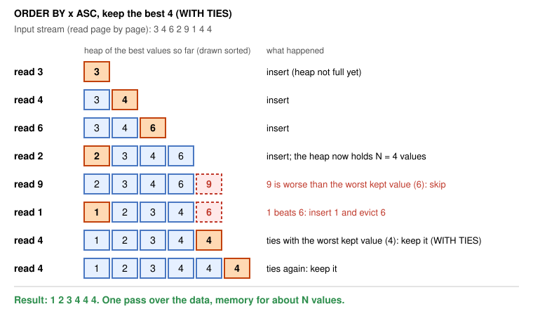
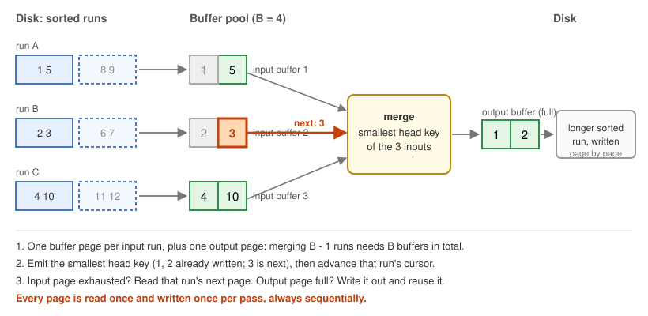
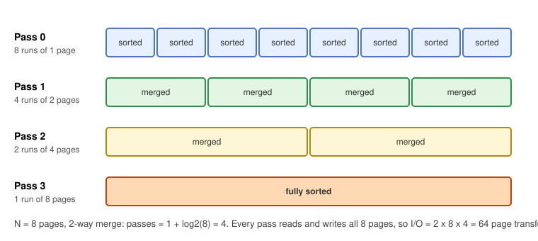
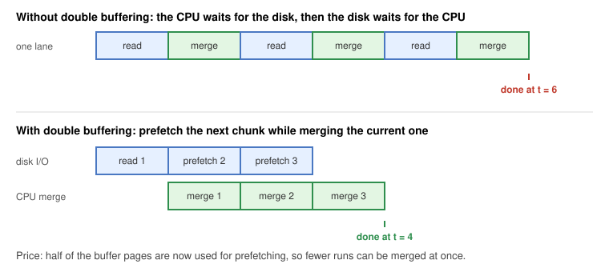
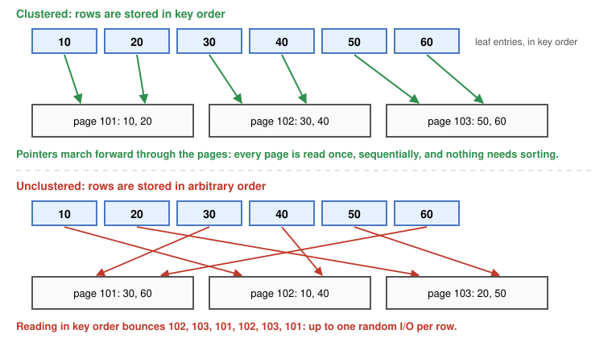
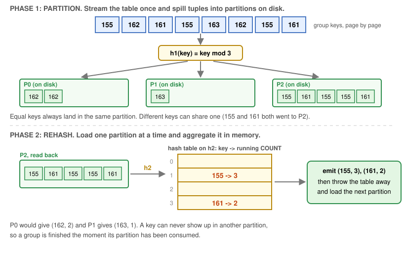
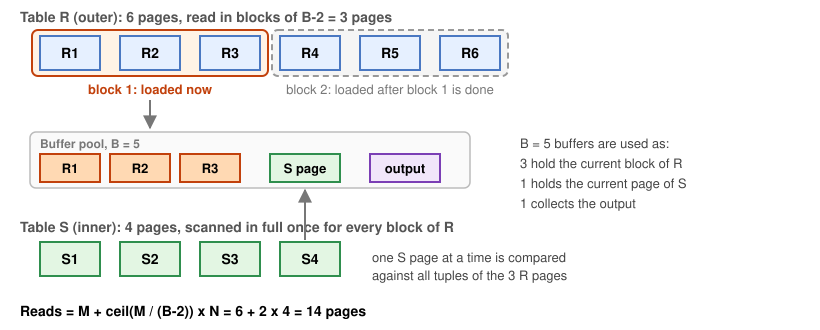
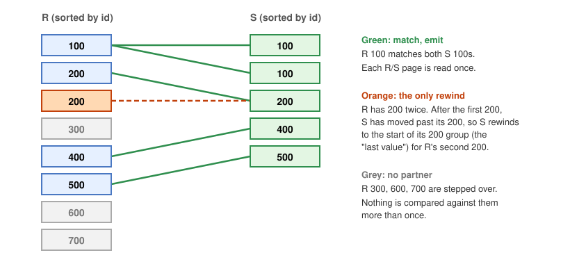
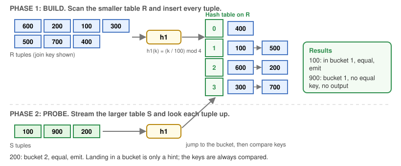
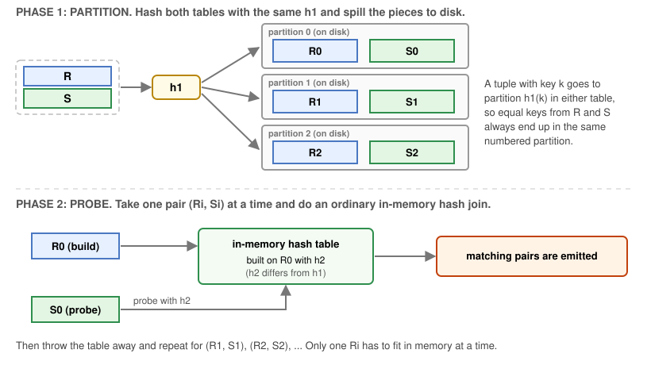

::: {.callout-note appearance="simple"}
**Slides this post is based on:** [Sorting and Aggregations](https://15445.courses.cs.cmu.edu/fall2025/slides/11-sorting.pdf) and [Joins](https://15445.courses.cs.cmu.edu/fall2025/slides/12-joins.pdf) from CMU 15-445/645 (Prof. Andy Pavlo).

The ideas come from those slides. The diagrams, examples and analogies are my own, so any mistakes are mine. The post has three parts: **sorting**, **aggregations**, and **joins**.
:::

## Where we are in the stack

So far we have looked at how a database stores pages on disk, caches them in a [buffer pool](../buffer-pool/index.qmd), and finds rows quickly with [indexes](../indexes/index.qmd). Now we turn to the layer above: **executing a query**.

A SQL query is turned into a **plan**: a tree of operators (scan, filter, sort, group, join...). Data flows from the leaves up to the root, and whatever the root emits is the answer.

Each operator is an *algorithm*, and each algorithm has to live with one uncomfortable fact:

> A disk-oriented DBMS cannot assume that a table fits in memory, and it cannot assume that the **intermediate results** of a query fit in memory either.

So the rules of the game for this whole post are:

- Use the **buffer pool** for working memory, and **spill to disk** when it is not enough.
- Prefer algorithms that do **sequential I/O**, because reading consecutive pages is far cheaper than hopping around.
- Count cost in **page I/Os**, since that dominates CPU time when data lives on disk.

## Why would a database sort at all?

SQL is built on the relational model, which is **unordered**: a table is a set of rows with no inherent order. Yet sorting shows up everywhere:

- The user asks for it: `ORDER BY`.
- **`DISTINCT`** becomes trivial on sorted data: duplicates sit next to each other.
- **`GROUP BY`** becomes trivial too: all rows of a group are adjacent.
- **Bulk-loading a B+Tree** is much faster if you feed it sorted keys (see the bulk insert section of the [indexes post](../indexes/index.qmd)).

So a sorting operator is a workhorse, and it has to work on data of any size.

## Sorting

### If it fits in memory, life is easy

When all the data fits in RAM, the DBMS just uses a standard algorithm: QuickSort, TimSort, RadixSort, or something tuned for nearly-sorted input. Nothing database-specific is needed.

The interesting case is when the data is **bigger than memory**. Then the algorithm must be aware of the cost of reading and writing pages.

### What exactly gets sorted?

A sort takes a list of entries and orders them by a **key** (the column or columns in `ORDER BY`). The question is what travels along with the key, the **value**:

| Approach | What is sorted | Pros / cons |
|---|---|---|
| **Early materialization** | `(key, whole tuple)` | Output is ready to use, no extra lookups. But every move copies the full tuple. |
| **Late materialization** | `(key, record id)` | Tiny entries, cheap to shuffle. But afterwards each record id must be followed back to the table to fetch the row, which is random I/O. |

### Top-N: do not sort everything, keep a leaderboard

Suppose the query is:

```sql
SELECT * FROM enrolled
 ORDER BY sid ASC
 FETCH FIRST 4 ROWS WITH TIES;
```

You want the best 4 rows out of a billion. Sorting the whole table to throw away almost everything would be silly.

**The idea.** Scan the table **once**, page by page, while maintaining a small in-memory **priority queue** (the lecture calls it a sorted heap) that holds the best $N$ rows seen so far. Think of it as a leaderboard with $N$ slots:

- If the leaderboard is not full, the new row gets in.
- If it is full, compare the new row with the **worst** row on the board. If the new row is better, it takes that place and the old worst row is dropped. Otherwise, throw the new row away.

A subtlety your intuition might trip on: to keep the **smallest** $N$ you want quick access to the **largest** one on the board (the one to evict), so the heap is a *max*-heap in that case. To keep the largest $N$, use a *min*-heap. In both cases the heap's root is "the worst of the winners."

{#fig-topn fig-alt="A step-by-step table. Each row shows one input value being read and the heap contents after it: values are inserted until the heap has 4 entries, 9 is skipped, 1 evicts 6, and two more 4s are kept because they tie with the worst kept value."}

Notice `WITH TIES`: once the 4th place is held by a `4`, any later `4` ties with it and must also be returned, which is why the answer in @fig-topn has six rows.

**Cost.** One sequential scan, $O(\log N)$ work per row for the heap, and memory for only about $N$ rows. This is the ideal plan whenever the top-$N$ fits in memory. If $N$ itself is too big, we need the general algorithm below.

### External merge sort

Now the full problem: sort a table of $N$ pages using only $B$ pages of buffer memory, where $B \ll N$.

**The analogy.** You have to alphabetize ten thousand index cards but your desk only fits 100 at a time. So you:

1. Take 100 cards, sort them on the desk, and put them down as a **sorted pile**. Repeat until all the cards are in sorted piles.
2. Merge piles: look at the top card of several piles, take the smallest, repeat. Merged piles become bigger sorted piles.
3. Keep going until one pile remains.

That is **external merge sort**, a divide-and-conquer algorithm. Each sorted pile is called a **run**, and the algorithm makes several passes over the data, not one.

```{mermaid}
%%| fig-cap: "External merge sort in two kinds of passes."
flowchart TD
    A["Unsorted table: N pages on disk"] --> B["Pass 0: read B pages, sort them in memory, write them out as one sorted run"]
    B --> C{"More pages left?"}
    C -- "yes" --> B
    C -- "no" --> D["About N/B sorted runs on disk"]
    D --> E["Pass 1, 2, ...: merge B-1 runs at a time into one longer run, using 1 buffer for output"]
    E --> F{"Only one run left?"}
    F -- "no" --> E
    F -- "yes" --> G["Fully sorted file"]
```

#### Pass 0: make sorted runs

Fill all $B$ buffer pages with data from the table, sort them in memory with any algorithm you like, and write them back out as a run of $B$ pages. Repeat until the table is consumed. You end up with $\lceil N/B \rceil$ sorted runs.

#### Pass 1, 2, 3...: merge runs

Now take as many runs as the buffer allows. With $B$ buffers, one is reserved for the **output**, so you can merge $B - 1$ runs at once (a $(B-1)$-way merge). Each input run gets exactly one buffer page.

{#fig-merge fig-alt="Three sorted runs on disk feed three input buffers. A merge box picks the smallest head key, here 3 from run B, and sends keys to an output buffer holding 1 and 2, which is flushed to a longer sorted run on disk."}

Look at @fig-merge. Because every run is sorted, the smallest key left among all the runs must be one of the runs' *current first* keys. So the merge only ever compares a handful of head keys (a tiny heap makes this cheap). Whenever an input page is used up, read that run's next page; whenever the output page fills up, write it out. No page is ever held longer than needed.

Repeat these passes: each one turns groups of $B-1$ runs into a single longer run, until one run, the sorted file, remains.

#### The 2-way version

The simplest version uses only $B = 3$ buffers: two input pages and one output page, merging pairs of runs. Each pass doubles the run length:

{#fig-passes fig-alt="Four horizontal bands. Pass 0 has 8 blocks of one page, pass 1 has 4 blocks of two pages, pass 2 has 2 blocks of four pages, pass 3 has one block of eight pages."}

The number of passes is $1 + \lceil \log_2 N \rceil$, and **every pass reads and writes every page**, so:

$$
\text{I/O cost} = 2N \cdot (\text{number of passes})
$$

#### The general version

With $B$ buffers, pass 0 produces $\lceil N/B \rceil$ runs and each later pass merges $B-1$ of them, so:

$$
\text{passes} = 1 + \left\lceil \log_{B-1} \left\lceil \frac{N}{B} \right\rceil \right\rceil
\qquad
\text{I/O cost} = 2N \cdot \text{passes}
$$

**Worked example** (from the slides): sort $N = 108$ pages with $B = 5$ buffers.

| Pass | What happens | Result |
|---|---|---|
| 0 | Sort chunks of 5 pages: $\lceil 108/5 \rceil$ | 22 runs of 5 pages (the last one has 3) |
| 1 | Merge 4 runs at a time: $\lceil 22/4 \rceil$ | 6 runs of 20 pages (the last one has 8) |
| 2 | Merge 4 runs at a time: $\lceil 6/4 \rceil$ | 2 runs, of 80 and 28 pages |
| 3 | Merge the last 2 | 1 sorted run of 108 pages |

That is $1 + \lceil \log_4 22 \rceil = 1 + \lceil 2.23 \rceil = 4$ passes, so $2 \times 108 \times 4 = 864$ page I/Os.

**How far does this scale?** After pass 0 there are about $N/B$ runs. If that number is at most $B-1$, a single merge pass finishes the job, so **two passes** suffice whenever

$$
N \le B \cdot (B - 1)
$$

With a buffer of just $B = 1000$ pages of 16 KB (about 16 MB), that is roughly a million pages, or **~16 GB**, sorted in two passes. A third pass pushes the limit to about $B(B-1)^2$ pages, around 16 TB. This is why external sorting is practical: the number of passes grows incredibly slowly.

A concrete comparison for $N = 900{,}000$ pages:

| Algorithm | Passes | I/O |
|---|---|---|
| 2-way merge ($B = 3$) | $1 + \lceil \log_2 900000 \rceil = 21$ | $2 \cdot 900000 \cdot 21 = 37.8$ M |
| General merge with $B = 1000$ | 2 | $2 \cdot 900000 \cdot 2 = 3.6$ M |

The only thing that changed is how much buffer memory we use, and the I/O dropped by about 10x.

#### Double buffering

There is still a hidden inefficiency: while the DBMS waits for a page to come from disk, the CPU sits idle, and while the CPU merges, the disk sits idle.

**Double buffering** overlaps them. While the CPU merges the current chunk, a background request **prefetches** the next chunk into a second set of buffers.

{#fig-dbuf fig-alt="A timeline. Without double buffering, read and merge blocks alternate on a single lane and finish at time 6. With double buffering, reads and merges run in parallel lanes and finish at time 4."}

The price is that half of the buffer pages are now reserved for prefetching, so the effective $B$ shrinks and fewer runs can be merged per pass. Usually that trade is worth it, because I/O wait is the bigger cost. The slides' conclusion on sorting is the same pair of ideas: **chunk I/O into large blocks** to amortize the cost, and **double-buffer** to overlap CPU and I/O.

### Making comparisons cheaper

Sorting is dominated by comparisons, so databases shave them down:

**1. Code specialization.** A generic sort takes a *comparison function pointer*, which means an indirect call for every comparison. Instead, the DBMS can generate (or compile, using templates or JIT) a version of the sort that is **hard-coded for the key type**: "sort 4-byte integers ascending." The comparison is then inlined and the CPU can optimize it, with no pointer chasing. The decision about *how* to compare is made before the sort runs, not during it.

**2. Suffix truncation** (as the slides call it here). Comparing long `VARCHAR`s is slow. So first compare a short fixed-size **binary prefix** of each key, say the first 8 bytes. Most of the time the prefixes already differ and you are done. Only if they are equal fall back to the slow full comparison.

**3. Key normalization.** Transform a (possibly multi-column, variable-length, mixed-direction) key into a **single byte string** such that comparing the bytes with a plain `memcmp` gives the correct sort order. One common trick for a signed 32-bit integer is to flip its sign bit and store it big-endian:

| Value | Normalized bytes |
|---|---|
| -1 | `7F FF FF FF` |
| 0 | `80 00 00 00` |
| 1 | `80 00 00 01` |

Now unsigned byte comparison orders them correctly: $-1 < 0 < 1$. (That example is my illustration of the idea; the slides only name the technique.)

### Can an index do the sorting for us?

If the table already has a B+Tree on the sort key, we may not need to sort at all: walk the leaf level from left to right and the keys come out in order. Whether this is a good idea depends on whether the index is clustered.

{#fig-clustered fig-alt="Two panels. In the clustered panel, arrows from leaf entries 10 to 60 point to pages 101, 102 and 103 in order. In the unclustered panel, the arrows cross because the rows live on pages in a scrambled order."}

**Case 1: clustered B+Tree.** The rows themselves are stored in key order. Go to the leftmost leaf and follow the sibling pointers. All disk access is **sequential**, and there is no sorting cost. The lecture's verdict: this is **always better** than an external sort.

**Case 2: unclustered B+Tree.** Each leaf entry points to a row somewhere else. Following those pointers in key order means **roughly one random I/O per row**. The verdict: this is **almost always a bad idea**, with one exception: **Top-N queries with a small N**, where you only chase a few pointers.

(In the [indexes post](../indexes/index.qmd) we saw a mitigation, *index scan page sorting*, which fetches the pages in page order instead of key order. That only helps when you do not need the output in key order.)

## Aggregations

An **aggregation** collapses many rows into one value per group: `SUM`, `COUNT`, `AVG`, `MIN`, `MAX`, with or without `GROUP BY`. `DISTINCT` is the same idea in disguise: "group by every column, output the groups."

The core problem is: **find all rows with the same key and bring them together**. There are exactly two ways to do that:

1. **Sort** the rows so equal keys are adjacent.
2. **Hash** the rows so equal keys land in the same place.

### Aggregation by sorting

Take this query:

```sql
SELECT DISTINCT cid
  FROM enrolled
 WHERE grade IN ('B', 'C')
 ORDER BY cid;
```

```{mermaid}
%%| fig-cap: "The plan for DISTINCT + ORDER BY using sorting."
flowchart LR
    A["Scan enrolled"] --> B["Filter: grade in (B, C)"]
    B --> C["Project: keep only cid"]
    C --> D["Sort by cid"]
    D --> E["Drop adjacent duplicates"]
    E --> F["Result"]
```

Filter and projection shrink the data *before* the sort, which makes the sort cheaper (fewer pages). After sorting, duplicates are neighbours, so a single pass that skips a row equal to the previous one removes them. And the output is already ordered, so the one sort satisfies both `DISTINCT` and `ORDER BY`.

**Running totals.** For `GROUP BY` the same trick works with a **running value** per group. Each aggregate needs a tiny piece of state:

| Aggregate | State kept while scanning |
|---|---|
| `COUNT(col)` | count |
| `SUM(col)` | sum |
| `MIN(col)` / `MAX(col)` | current min / max |
| `AVG(col)` | **(count, sum)**; divide at the end |

Because the input is sorted, once the key changes, that group is **complete** and can be emitted immediately, then the state resets for the next group. Here is `AVG(gpa) ... GROUP BY cid` from the slides, on the sorted rows:

| Sorted row (cid, gpa) | Key changed? | Running state `(count, sum)` | Output |
|---|---|---|---|
| 15-445, 3.62 | start | (1, 3.62) | |
| 15-445, 3.70 | no | (2, 7.32) | |
| 15-721, 3.33 | **yes** | (1, 3.33) | **15-445: 7.32 / 2 = 3.66** |
| 15-826, 2.89 | **yes** | (1, 2.89) | **15-721: 3.33** |
| end of input | | | **15-826: 2.89** |

Memory use is tiny (one running state), and the only expensive part is the sort itself.

### Aggregation by hashing

Sorting does more work than needed when the query does **not** care about order. `GROUP BY` and `DISTINCT` only need rows with equal keys to meet; they do not need the groups in any particular order. Hashing is the better tool: no ordering means a computationally cheaper algorithm.

**If everything fits in memory**, it is easy: build a hash table as you scan.

- `DISTINCT`: if the key is already in the table, discard the row; otherwise insert it.
- `GROUP BY`: if the key is in the table, update its running value; otherwise insert a new entry.

The table holds `GroupKey -> RunningValue` pairs, using the same running-value state as above (so `AVG` stores `(count, sum)`).

**If it does not fit**, we need external hashing aggregation, which again is divide-and-conquer, in two phases. Here it is on a small example, grouping these keys (with `h1(key) = key mod 3` just for illustration):

{#fig-hashagg fig-alt="Top: eight keys flow through hash function h1 into three on-disk partitions P0, P1 and P2. Bottom: partition P2 is read back, hashed with h2 into an in-memory table that holds 155 with count 3 and 161 with count 2, which are then emitted."}

**Phase 1: partition.** Scan the table and apply a hash function $h_1$ to each key to choose a **partition**. With $B$ buffers, use $B-1$ as output buffers (one per partition) and 1 as the input buffer. When a partition's buffer fills, write it to disk. After the scan, every row is in some partition file on disk.

The key property: **equal keys always go to the same partition** (same input, same hash). Different keys *can* share a partition, as 155 and 161 do in @fig-hashagg.

**Phase 2: rehash.** For each partition, one at a time:

1. Read it into memory.
2. Build an in-memory hash table with a **second** hash function $h_2$, storing `GroupKey -> RunningValue`.
3. When the partition is exhausted, **emit** the table's contents as final results.
4. Throw the table away and move on to the next partition.

Step 4 is safe precisely because of the property above: since all copies of 155 were in this partition, no other partition will ever contain 155. Each group is complete the moment its partition is done.

A few details worth understanding:

- **Why a *different* function $h_2$?** Every key in one partition has the same $h_1$ value (that is why they are together). Using $h_1$ again inside the partition would drop all of them into one bucket. A second, independent function spreads them out.
- **The table is small.** What sits in memory is one entry **per distinct group**, not one entry per row. A partition with a million rows but 50 distinct keys needs a 50-entry table. This is what makes hash aggregation so economical.
- **The assumption.** The slides assume each partition's table fits in memory. If one does not, the usual escape is to partition that partition again with yet another hash function (the same recursive idea reappears with joins).
- **I/O cost, back of the envelope.** Phase 1 reads the table and writes the partitions; phase 2 reads the partitions back. With no filtering that is roughly $3N$ page I/Os, regardless of how large $N$ is. Compare that with sorting, which needs at least $2N \times 2 = 4N$ even in the best two-pass case. (This is my estimate, not a number from the slides.)

### Sorting or hashing?

| | Sort-based | Hash-based |
|---|---|---|
| Output order | Sorted by the group key (free `ORDER BY`) | Arbitrary |
| Typical cost | A full external sort (2 or more passes) | Partition once, read once |
| Memory | Needs merge buffers | One table entry per group |
| Skewed data | Handles uneven key distributions gracefully | A very popular key makes one partition huge |
| Best when | The result must be sorted, or data is already sorted/indexed | Order is irrelevant |

The lecture's conclusion is that the choice is subtle and depends on the optimizations on each side. Hashing is usually cheaper when you do not need order; sorting wins when the output must be sorted or the data is lopsided. Good systems implement **both** and let the optimizer choose.

## Joins

### Why joins exist

A well-designed relational schema is **normalized**: facts are stored once instead of being copied into every row that mentions them. A customer's name lives in a `customers` table, and each order only stores a `customer_id`. That avoids repetition, but the price is that the data you want is now spread over several tables.

The **join** operator pays that price back. It reassembles the original, wide tuples from the narrow ones without losing any information.

This post only looks at **binary inner equijoins**: two tables, matched with `R.id = S.id`. Other join types are variations of the same algorithms, and joins of three or more tables are normally executed as a sequence of binary joins.

One convention to know up front: in the plan, the **smaller table is the left one, the "outer" table**, and the larger one is the "inner" table. The optimizer tries to arrange this when it builds the physical plan.

```sql
SELECT R.id, S.cdate
  FROM R JOIN S ON R.id = S.id
 WHERE S.value > 100;
```

### What does a join emit?

For every pair of tuples $r \in R$ and $s \in S$ that match, the join produces one output tuple. What goes *into* that tuple is a design choice:

| Approach | Output of the join | Trade-off |
|---|---|---|
| **Early materialization** | Copy all needed attribute values of $r$ and $s$ into a new tuple | Later operators never need to go back to the base tables. The tuples are bigger, though. |
| **Late materialization** | Only the join key plus the **record ids** of $r$ and $s$ | Very small output, and a good fit for column stores because unneeded columns are never copied. Later operators have to fetch the real values using the record ids. |

This is the same early/late distinction we saw for sorting.

### How do we compare join algorithms?

Let table $R$ have $M$ pages and $m$ tuples, and table $S$ have $N$ pages and $n$ tuples. The cost metric is again the **number of page I/Os**. The cost of writing the output is ignored, because it is the same for every algorithm.

All examples below use the numbers from the slides, with a disk that takes 0.1 ms per I/O:

- $R$: $M = 1000$ pages, $m = 100{,}000$ tuples
- $S$: $N = 500$ pages, $n = 40{,}000$ tuples

One more remark: you could in principle compute the cross product $R \times S$ and then filter it, but the cross product is gigantic, and there is no clever algorithm that rescues that. Joins are so common that all the effort goes into avoiding it.

### Nested loop joins

The family of nested loop joins is the most direct translation of the definition of a join: *for each tuple in one table, look for partners in the other.*

#### Naive nested loop join

Two plain `for` loops:

```text
for each tuple r in R:          # outer
    for each tuple s in S:      # inner
        if r and s match: emit
```

Every tuple of $R$ is compared to every tuple of $S$. It is simple, and it is the baseline every other algorithm is trying to beat. The problem is the I/O: for **each tuple** of $R$ we scan **all of $S$** from disk once.

$$
\text{cost} = M + (m \cdot N)
$$

The first $M$ is reading $R$ once. Then comes $m$ full scans of $S$, each $N$ pages long.

With the example tables: $1000 + 100{,}000 \cdot 500 = 50{,}001{,}000$ I/Os, which at 0.1 ms each is about **1.4 hours**. Making the smaller table the outer one helps only a little: $500 + 40{,}000 \cdot 1000 = 40{,}000{,}500$ I/Os, about 1.1 hours.

Note that the number of **tuples** appears in this formula. That is the whole problem: we pay per tuple, even though a disk reads whole pages.

#### Block nested loop join

The fix is to stop looping per tuple and loop per **block of pages**. Read a block of the outer table into memory and then scan the inner table **once** for the *whole block*, comparing each inner tuple with every outer tuple in memory. The number of scans of $S$ then depends on the number of blocks of $R$, not the number of tuples.

```text
for each block B_R in R:
    for each block B_S in S:
        for each tuple r in B_R:
            for each tuple s in B_S:
                if r and s match: emit
```

If a "block" is a single page, the cost is already much better:

$$
\text{cost} = M + (M \cdot N)
$$

because $S$ is scanned $M$ times (once per page of $R$) instead of $m$ times (once per tuple). With the example tables that is $1000 + 1000 \cdot 500 = 501{,}000$ I/Os, about 50 seconds. Note that the table with *fewer pages* should be the outer table, and the comparison is in pages, not tuples.

It gets better when we use more of the buffer pool. With $B$ buffers, use $B-2$ of them to hold a block of the outer table, 1 for the current page of the inner table, and 1 for the output:

{#fig-bnlj fig-alt="Table R with six pages split into two blocks of three. A buffer pool with five buffers: three hold the current block of R, one holds the current page of S, and one is the output buffer. Table S with four pages is scanned once per block of R. The total is 6 plus 2 times 4 equals 14 page reads."}

$$
\text{cost} = M + \left\lceil \frac{M}{B-2} \right\rceil \cdot N
$$

The numbers for the example:

| Situation | Cost | Time |
|---|---|---|
| Outer table fits entirely in memory ($M < B-2$) | $M + N = 1500$ | 0.15 s |
| $B = 102$ buffers, $R$ outer | $1000 + \lceil 1000/100 \rceil \cdot 500 = 6000$ | 0.6 s |
| $B = 102$ buffers, $S$ outer (smaller table) | $500 + \lceil 500/100 \rceil \cdot 1000 = 5500$ | 0.55 s |

The first row deserves a remark: if one table fits in memory, we read each table exactly once and join them in memory, which is the best any algorithm can possibly do ($M + N$). Everything else in this post is about getting as close to that as possible when it does not fit.

#### Index nested loop join

Why is the nested loop join slow? Because for each outer tuple we run a **sequential scan** of the inner table just to find the few tuples that match. If the inner table already has an **index on the join column** (such as the B+Tree from the [indexes post](../indexes/index.qmd)), we can replace the scan with a lookup:

```text
for each tuple r in R:
    for each tuple s in Index(S.id = r.id):     # index probe instead of a scan
        emit (r, s)
```

If one index probe costs about $C$ I/Os (for a B+Tree, roughly its height plus the matching leaf and data pages), then

$$
\text{cost} = M + (m \cdot C)
$$

There is no fixed number here: it depends on $C$, which depends on the index. It is excellent when the outer table is small or filtered down to few tuples, since each outer tuple costs only one cheap lookup instead of a full scan. It is a poor choice when there is no index, and not great when the outer table is huge, since you pay $C$ for *every* tuple.

#### Nested loop takeaways

- Pick the **smaller table as the outer table**, when possible.
- **Buffer as much of the outer table in memory** as possible.
- Loop over the inner table, **or probe an index** on it.

### Sort-merge join

Nested loops compare tuples blindly. **Sort-merge join** uses the idea we met earlier: if both inputs are **sorted** on the join key, then matching tuples are found by a single coordinated walk over both tables, like a zipper.

**Phase 1, sort.** Sort $R$ and $S$ on the join key, with the external merge sort from earlier in this post (or by reading them through an index on the key).

**Phase 2, merge.** Keep one cursor on each sorted table, and compare the keys they point to:

1. **Equal:** the tuples match, so emit the combined tuple and advance the cursor on $S$.
2. **$R$ key < $S$ key:** $R$ is behind, so advance the cursor on $R$.
3. **$R$ key > $S$ key:** $S$ is behind, so advance the cursor on $S$.
4. Remember the **last key** that was matched. When $R$ moves to a tuple with the *same key as before*, the cursor on $S$ must **rewind** to the first tuple of that key, so the new $R$ tuple also meets all of its partners.

Here it is on the slides' example, with the sorted inputs $R$ = 100, 200, 200, 300, 400, 500, 600, 700 and $S$ = 100, 100, 200, 400, 500:

| Step | $R$ cursor | $S$ cursor | What happens |
|---|---|---|---|
| 1 | 100 | 100 | Match, emit. Advance $S$. |
| 2 | 100 | 100 (second) | Match, emit. Advance $S$. |
| 3 | 100 | 200 | $R$ < $S$: advance $R$. |
| 4 | 200 | 200 | Match, emit. Advance $S$. Last key = 200. |
| 5 | 200 | 400 | $R$ < $S$: advance $R$. The new $R$ key is 200 again, the last key, so **rewind $S$** to its first 200. |
| 6 | 200 (second) | 200 | Match, emit. Advance $S$. |
| 7 | 200 (second) | 400 | $R$ < $S$: advance $R$. |
| 8 | 300 | 400 | $R$ < $S$: advance $R$. No partner for 300. |
| 9 | 400 | 400 | Match, emit. Advance $S$. |
| 10 | 400 | 500 | $R$ < $S$: advance $R$. |
| 11 | 500 | 500 | Match, emit. $S$ is exhausted, so we are done. |

The rest of $R$ (600 and 700) is never even looked at.

{#fig-smj fig-alt="Two sorted columns, R and S, with lines connecting matching keys. R 100 connects to both S 100s, R 200 twice to the single S 200 (the second one drawn dashed to show the rewind), R 400 and R 500 to their S counterparts. R 300, 600 and 700 are greyed out with no match."}

#### Why is this better? What about the backtracking?

It is fair to be suspicious of the rewind: if we keep jumping back, are we not just doing a nested loop again? No, for two reasons.

**1. Sortedness lets you skip without looking.** In a nested loop, when $r$ has no partner, the algorithm only finds that out after comparing $r$ against the *entire* inner table. In the sorted version, one comparison is enough: if $s$ is already larger than $r$, then because $S$ is sorted, *everything after $s$ is larger too*, so $r$ cannot match anything and we move on. The cursors only ever walk forward through the data.

**2. The rewind is tiny and is paid for by the output.** We only go back over the **group of tuples with an identical key**, and every tuple in that group *does* match the new $r$. So the rewound tuples are not wasted comparisons: each one produces an output row that has to be emitted anyway. The extra work is proportional to the size of the result, not to the size of the tables. In practice the pages being revisited were just read, so they are typically still in memory.

Put together: when keys are unique or have only a few duplicates, each page of $R$ and $S$ is read **once**, and the merge costs

$$
\text{merge cost} = M + N
$$

The whole cost is the sort cost of both tables plus this:

$$
\text{cost} = \underbrace{2M \cdot \left(1 + \left\lceil \log_{B-1} \left\lceil \tfrac{M}{B} \right\rceil \right\rceil\right)}_{\text{sort } R} + \underbrace{2N \cdot \left(1 + \left\lceil \log_{B-1} \left\lceil \tfrac{N}{B} \right\rceil \right\rceil\right)}_{\text{sort } S} + (M + N)
$$

With $B = 100$ buffers both tables sort in two passes:

| Step | I/Os |
|---|---|
| Sort $R$: $2 \cdot 1000 \cdot 2$ | 4000 |
| Sort $S$: $2 \cdot 500 \cdot 2$ | 2000 |
| Merge: $1000 + 500$ | 1500 |
| **Total** | **7500** (about 0.75 s) |

You might notice that block nested loop with a similar buffer budget came out at about 6000 in the same example, so sort-merge is not magically faster here. The difference is how each one **scales**. Block nested loop cost grows like $\frac{M}{B-2} \cdot N$, which is a *product* of the table sizes, so doubling both tables roughly quadruples it. Sort-merge cost grows like $(M + N)$ times a few passes, which grows much more gently. The bigger the tables, the more the sort-merge approach wins. (This scaling comparison is my own summary of the formulas.)

**The worst case** is when every tuple in both tables has the same join key. Then every $r$ matches every $s$, the rewind covers the whole of $S$ each time, and the merge costs $M \cdot N$ plus the sorting. The output itself has $m \cdot n$ rows in that case, so any algorithm would be slow.

**When is sort-merge the right choice?**

- One or both tables are **already sorted** on the join key (for example, they are read through a B+Tree on that key, so the sort phase is free).
- The **output must be sorted** on the join key (for example, there is an `ORDER BY` on it), so the sort pays for two things at once.

### Hash join

Here is the key observation, the same one behind hash aggregation:

> If $r \in R$ and $s \in S$ satisfy the join condition, they have the **same join key**. So they hash to the **same place**. Therefore we only ever need to compare an $r$ with the $s$ tuples that landed in the same bucket.

In other words, a hash join builds a throw-away **index on the fly** for one of the tables, and then uses it just like the index nested loop join does. No sorting, and no scanning of the inner table for each outer tuple.

#### Simple hash join (everything fits in memory)

**Phase 1, build.** Scan the outer table $R$ and insert every tuple into an in-memory hash table using a hash function $h_1$ on the join key. (Linear probing hash tables tend to work best in practice, but any hash table from the earlier posts works.)

**Phase 2, probe.** Scan the inner table $S$. For each tuple, hash its key with $h_1$, jump to that bucket and compare against the entries found there. Emit each real match.

```text
for each tuple r in R:                 # build
    insert r into hash table HT using h1(r.key)
for each tuple s in S:                 # probe
    for each r in HT[h1(s.key)]:
        if r.key == s.key: emit (r, s)
```

{#fig-shj fig-alt="Top: seven R tuples flow through h1 into a hash table with four buckets, e.g. bucket 1 holds 100 and 500. Bottom: S tuples 100, 900 and 200 are hashed with h1 and looked up. 100 and 200 match and are emitted, while 900 lands in bucket 1 but finds no equal key."}

The **build** side is the one stored in memory, so the *smaller* table should be the build side (the outer table). The probe side is only streamed through, so it can be **any size**.

The cost is the same as the best case for any join: each table is read once, $M + N$ I/Os, as long as the hash table fits in memory. Because there is one lookup per tuple instead of a scan, the CPU cost is also low.

**Optimization: a probe filter (Bloom filter).** While building the hash table, the DBMS can also fill a **Bloom filter**: a small bit array that can answer "is this key *possibly* in the table?". It may give a false "maybe", but never a false "no". Before probing the real hash table, the probe side first asks the filter. If the answer is "no", the tuple is thrown away immediately. The filter is much smaller than the table and fits in the CPU cache, so rejecting non-matching tuples becomes cheap. The slides call this *sideways information passing*, since information from the build side flows over to the probe side.

### Partitioned hash join (GRACE)

What if the hash table of $R$ **does not fit in memory**? If we just build it anyway, the buffer pool will swap its pages in and out at random, and every probe becomes a random I/O. That is a disaster, so we do not do that.

Instead we use the same divide-and-conquer pattern as external hash aggregation. This algorithm is called **partitioned hash join**, or **GRACE hash join**, after the GRACE database machine built at the University of Tokyo in the 1980s.

**Phase 1, partition.** Hash **both** tables with the **same** function $h_1$ into $k$ partitions each, writing full partition buffers to disk. This gives partitions $R_0, \dots, R_{k-1}$ and $S_0, \dots, S_{k-1}$.

**Phase 2, probe.** For each $i$, load $R_i$ into memory, build a hash table on it (using a second function $h_2$), then stream $S_i$ through it and emit the matches.

{#fig-grace fig-alt="Top: tables R and S pass through the same hash function h1 and are split into three pairs of partitions R0/S0, R1/S1 and R2/S2 on disk. Bottom: partition pair 0 is joined by building an in-memory hash table on R0 using h2 and probing it with S0, producing matching pairs."}

Why is it correct to join the partitions independently? Because of the observation from the beginning: matching tuples have equal keys, equal keys have equal hashes, and equal hashes mean the same partition number. A tuple in $R_i$ can only ever match a tuple in $S_i$, never one in $S_j$ for $j \ne i$. So we never miss a match, and we never need to compare across partitions.

**Cost.** Phase 1 reads and writes both tables, which is $2(M + N)$. Phase 2 reads every partition back once, which is $M + N$. In total:

$$
\text{cost} = 3(M + N)
$$

For the example: $3 \cdot (1000 + 500) = 4500$ I/Os, about **0.45 seconds**, the best of all the algorithms so far. (This assumes that every partition fits in memory, which brings us to the edge cases.)

### Recursive partitioning and edge cases

What if some partition $R_i$ is *still* too big for memory after the first split? Split it again, using a **different** hash function, and repeat if necessary. The matching $S$ partition has to be split the same way so that the pairs stay aligned, and in the end the small sub-partition pairs are joined as before.

```{mermaid}
%%| fig-cap: "What the DBMS does when a partition is too big."
flowchart TD
    A["Partition R and S with h1 into k buckets"] --> B{"Does R bucket i fit in memory?"}
    B -- "yes" --> C["Build a hash table on R bucket i with h2, probe with S bucket i"]
    B -- "no" --> D{"Is it big because of many different keys,<br/>or because of ONE very frequent key?"}
    D -- "many keys" --> E["Re-partition R bucket i and S bucket i with a new hash function"]
    E --> B
    D -- "one key" --> F["Block nested loop join just for that key"]
```

The second branch is there because re-partitioning has a blind spot: **identical keys always hash to the same value**, so no hash function can split a pile of tuples that all share one key. For that rare case the slides suggest falling back to a **block nested loop join for that key only**, which at least reads sequentially instead of jumping around.

A few more observations about hash joins:

- **Only the build table (or its partitions) has to fit in memory.** The probe table can be any size.
- If the probe-side table happens to fit entirely in memory but the build-side does not, you can simply swap roles: build on the table that fits, and scan the other one past it, with no partitioning at all.
- If the DBMS does not know the size of the build table in advance, it needs a hash table that can grow, or one with overflow pages.

The partition fan-out also tells us when one level of partitioning is enough. With $B$ buffers we can write about $B-1$ partitions at once, each of size about $M/(B-1)$ pages, and each must fit in about $B-2$ buffers, so roughly $M \lesssim B^2$. (This is my own estimate, not a figure from the slides.) Notice that this is the same square-law as the two-pass limit for external sorting.

### The join algorithms side by side

| Algorithm | I/O cost | Example cost (0.1 ms/IO) |
|---|---|---|
| Naive nested loop | $M + m \cdot N$ | 1.4 hours |
| Block nested loop | $M + \lceil M/(B-2) \rceil \cdot N$ | 0.55 s |
| Index nested loop | $M + m \cdot C$ | depends on the index |
| Sort-merge | sort $R$ + sort $S$ + $(M + N)$ | 0.75 s |
| Hash (partitioned) | $3(M + N)$ | 0.45 s |

The conclusion of the lecture matches what we saw for aggregation: **hashing is almost always better than sorting** for executing operators. The exceptions are the same two as before: sorting is better on **non-uniform (skewed) data**, and when the **result has to be sorted**. A good DBMS implements both, and the optimizer picks.

## Cheat sheet

| Idea | One-line summary |
|---|---|
| Top-N heap | One scan, keep a size-$N$ leaderboard; evict the worst when a better row arrives |
| External merge sort | Pass 0 makes $\lceil N/B \rceil$ sorted runs; later passes merge $B-1$ runs at a time |
| Cost | $2N \cdot (1 + \lceil \log_{B-1} \lceil N/B \rceil \rceil)$ page I/Os |
| Two-pass limit | $N \le B(B-1)$ pages |
| Double buffering | Prefetch the next chunk during the merge; costs half the buffers |
| Comparison tricks | Specialize code by type, compare short prefixes first, normalize keys to bytes |
| Index for sorting | Clustered: always good. Unclustered: only for small Top-N |
| Sort aggregation | Sorted input means a group ends when the key changes; keep running totals |
| Hash aggregation | Partition with $h_1$ to disk, then aggregate each partition in memory with $h_2$ |
| Naive nested loop join | Two loops over tuples; scans $S$ once per tuple of $R$: $M + m \cdot N$ |
| Block nested loop join | Load a block of $B-2$ outer pages, scan $S$ once per block: $M + \lceil M/(B-2) \rceil \cdot N$ |
| Index nested loop join | One index probe on the inner table per outer tuple: $M + m \cdot C$ |
| Sort-merge join | Sort both, then one forward sweep with a short rewind over equal-key groups |
| Hash join | Build a hash table on the smaller table, probe it with the larger one |
| Partitioned (GRACE) hash join | Split both tables with $h_1$, join each pair in memory with $h_2$: $3(M + N)$ |
| Recursive partitioning | Re-split oversized partitions with a new hash function; one hot key falls back to block nested loop |

Both of the big ideas in this post, **sorting** and **hashing**, are about bringing equal keys together. Aggregation needs that for rows of one table, and a join needs it for rows of two.

## References

- **Slides:** [Sorting and Aggregations](https://15445.courses.cs.cmu.edu/fall2025/slides/11-sorting.pdf) and [Joins](https://15445.courses.cs.cmu.edu/fall2025/slides/12-joins.pdf), CMU 15-445/645 Fall 2025, Prof. Andy Pavlo.
- **Course website:** [15445.courses.cs.cmu.edu](https://15445.courses.cs.cmu.edu/)
- Previous posts on this blog: [the buffer pool](../buffer-pool/index.qmd) and [database indexes](../indexes/index.qmd).
